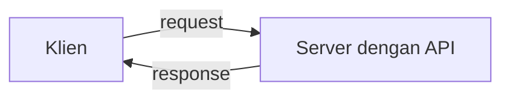

# Apa itu FastAPI

## Tujuan pembelajaran

Setelah membaca halaman ini, kamu mampu:

- [ ] Menjelaskan apa itu API dan peran *framework* dalam membuatnya.
- [ ] Menjelaskan apa itu FastAPI dan komponen utama yang menyusunnya.
- [ ] Menyebutkan fitur utama FastAPI beserta alasan fitur itu berguna.
- [ ] Menilai kapan FastAPI cocok dipakai.

## Masalah yang ingin diselesaikan

Bayangkan aplikasi di ponsel yang menampilkan daftar tugas. Daftar itu tidak disimpan di ponsel, melainkan di sebuah server. Aplikasi ponsel perlu cara untuk meminta data ke server, dan server perlu cara untuk menjawabnya.

Cara berkomunikasi itu disebut **API** (*Application Programming Interface*): seperangkat aturan yang menentukan apa yang boleh diminta ke sebuah program dan seperti apa jawabannya. Pihak yang meminta disebut **klien** (*client*), misalnya aplikasi ponsel, situs web, atau program lain. Pihak yang menjawab adalah **server**.

Untuk web, komunikasi ini berjalan lewat protokol HTTP. Setiap permintaan dari klien disebut *request*, dan jawaban dari server disebut *response*. Cara kerja HTTP dibahas tersendiri di materi berikutnya pada [Modul 01](index.md), jadi halaman ini hanya memakai istilahnya secara ringkas.

Membuat server yang menangani request, memeriksa data yang masuk, dan menyusun response dari nol itu pekerjaan yang panjang dan berulang. **Framework** adalah kumpulan alat siap pakai yang mengerjakan bagian yang berulang itu, sehingga kamu bisa fokus pada logika aplikasimu.

## Definisi FastAPI

Menurut dokumentasi resminya, FastAPI adalah framework web modern dan berkinerja tinggi untuk membangun API dengan Python, yang berbasis *type hints* standar Python.

*Type hints* adalah penanda tipe data pada kode Python, misalnya menyatakan bahwa sebuah nilai berupa angka bulat atau teks. FastAPI membaca penanda itu dan memakainya untuk pekerjaan lain, yaitu memeriksa data dan membuat dokumentasi. Inilah ide inti FastAPI: **satu deklarasi tipe dipakai untuk banyak keperluan**.

## Komponen yang menyusun FastAPI

FastAPI tidak bekerja sendirian. Dokumentasi resminya menyebut dua fondasi utama:

| Komponen | Tugasnya |
|---|---|
| **Starlette** | Bagian web: menangani request dan response |
| **Pydantic** | Bagian data: memeriksa dan mengubah data berdasarkan tipe |

Untuk menjalankan aplikasi, dibutuhkan satu lagi: **Uvicorn**, yaitu server yang menjalankan aplikasi FastAPI, seperti disebut di halaman utama dokumentasi resmi. Cara memasang dan memakainya dibahas pada materi instalasi dan menjalankan server.

!!! note "Hubungan antarkomponen"
    Kamu menulis aplikasi memakai FastAPI. Di balik layar, Starlette mengurus sisi web, Pydantic mengurus sisi data, dan Uvicorn menjalankannya sebagai server.

## Fitur utama dan alasannya

Daftar berikut mengacu pada halaman resmi FastAPI.

| Fitur | Artinya | Mengapa berguna |
|---|---|---|
| Validasi data otomatis | Data masuk diperiksa berdasarkan tipe yang kamu deklarasikan | Kamu tidak perlu menulis pemeriksaan manual untuk setiap field |
| Dokumentasi otomatis | Dokumentasi API dibuat dari kodemu | Dokumentasi selalu sesuai dengan kode, dan dapat dipakai untuk mencoba API |
| Dukungan editor | Autocompletion dan pengecekan di editor seperti Visual Studio Code dan PyCharm | Kesalahan penulisan lebih cepat ketahuan |
| Beragam sumber parameter | Parameter dari path, query, body, cookie, header, form, dan file | Satu cara yang konsisten untuk membaca data dari request |
| *Dependency injection* | Cara berbagi logika antar bagian aplikasi | Mengurangi pengulangan kode |
| Keamanan | Dukungan antara lain OAuth2 dengan JWT dan HTTP Basic | Dasar untuk melindungi API |

Masing-masing fitur ini diajarkan pada modul yang relevan. Halaman ini hanya memperkenalkan gambaran besarnya.

### Dokumentasi interaktif otomatis

Fitur yang paling terasa bagi pemula adalah dokumentasi otomatis. FastAPI membuatnya berdasarkan standar terbuka:

- **OpenAPI**: standar untuk mendeskripsikan sebuah API, yaitu path, parameter, request body, dan keamanannya.
- **JSON Schema**: standar untuk mendeskripsikan bentuk data JSON. OpenAPI sendiri berbasis JSON Schema.

Dari deskripsi itu, FastAPI menyediakan dua tampilan dokumentasi secara bawaan:

| Tampilan | Alamat bawaan | Kegunaan |
|---|---|---|
| **Swagger UI** | `/docs` | Menjelajahi API dan memanggilnya langsung dari browser |
| **ReDoc** | `/redoc` | Tampilan dokumentasi alternatif |

Cara membukanya dipraktikkan pada materi aplikasi pertama.

## Tentang klaim performa

Dokumentasi FastAPI menyebut performanya termasuk yang tercepat di antara framework Python dan setara dengan NodeJS dan Go. Perlu dicatat bahwa dokumentasi menyampaikan klaim ini dalam bagian tentang Starlette, dan tautannya mengarah ke bagian performa di repositori Starlette, bukan ke pengukuran FastAPI sendiri.

Artinya, klaim ini adalah klaim dari pembuat framework. Materi ini tidak mengukurnya, sehingga **belum diverifikasi**. Kecepatan nyata aplikasimu juga bergantung pada kodemu, basis data, dan lingkungan penyebarannya.

## Kapan FastAPI cocok?

FastAPI dirancang untuk **membangun API**. Ia cocok bila:

- Kamu membuat API untuk dipakai aplikasi ponsel, situs web, atau layanan lain.
- Kamu ingin data masuk divalidasi otomatis.
- Kamu ingin dokumentasi API yang selalu sesuai dengan kode.
- Kamu sudah nyaman menulis Python dengan type hints, atau bersedia mempelajarinya.

Sebelum memilih framework untuk proyek nyata, bandingkan dengan kebutuhan dan kebiasaan timmu. Halaman ini tidak membandingkan FastAPI dengan framework lain karena perbandingan itu butuh pengujian yang belum dilakukan di sini.

## Kesalahan pemahaman yang umum

| Anggapan | Penjelasan |
|---|---|
| "FastAPI itu server" | FastAPI adalah framework. Server yang menjalankannya, seperti Uvicorn, adalah komponen terpisah |
| "FastAPI menggantikan Pydantic atau Starlette" | FastAPI dibangun di atas keduanya, bukan menggantikannya |
| "Type hints hanya hiasan" | Pada FastAPI, type hints dipakai untuk validasi dan dokumentasi |

## Latihan

1. **Dasar.** Dengan kata-katamu sendiri, jelaskan perbedaan antara *API*, *framework*, dan *server*. Tulis satu kalimat untuk masing-masing.
2. **Menengah.** Pasangkan komponen berikut dengan tugasnya: Starlette, Pydantic, Uvicorn. Tugas: (a) memeriksa dan mengubah data, (b) menjalankan aplikasi sebagai server, (c) menangani sisi web.
3. **Tantangan.** Buka halaman resmi FastAPI di <https://fastapi.tiangolo.com/> dan temukan satu fitur yang tidak ada di tabel fitur di atas. Tuliskan nama fitur itu dan satu kalimat tentang kegunaannya.

??? success "Petunjuk jawaban"
    Latihan 2: Starlette → (c), Pydantic → (a), Uvicorn → (b). Latihan 1 dan 3 tidak punya jawaban tunggal; periksa jawabanmu terhadap definisi pada halaman ini dan halaman resmi.

## Ringkasan

- API adalah aturan komunikasi antara klien dan server. Framework membantu membuat server itu tanpa mengulang pekerjaan dasar.
- FastAPI adalah framework Python untuk membangun API, berbasis type hints.
- Fondasinya: Starlette untuk sisi web dan Pydantic untuk sisi data. Aplikasi dijalankan oleh server seperti Uvicorn.
- Satu deklarasi tipe dipakai untuk validasi data dan dokumentasi otomatis (OpenAPI, Swagger UI, ReDoc).
- Klaim performa berasal dari pembuat framework dan belum diverifikasi di materi ini.

## Langkah berikutnya

Lanjutkan ke materi berikutnya pada [Modul 01: Pengenalan](index.md). Daftar lengkap ada di [Kurikulum](../index.md).
