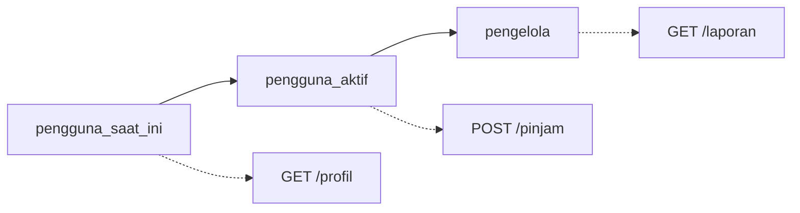

# Dependency Berantai

## Tujuan pembelajaran

Setelah membaca halaman ini, kamu mampu:

- [ ] Menyusun dependency yang bergantung pada dependency lain (sub-dependency).
- [ ] Menjelaskan urutan eksekusi rantai dependency dan di mana rantai berhenti saat ada penolakan.
- [ ] Membangun tingkatan pemeriksaan yang bertambah ketat tanpa menulis ulang pemeriksaan sebelumnya.
- [ ] Menjelaskan bahwa dependency yang sama dalam satu request hanya dijalankan sekali, dan cara mematikannya dengan `use_cache=False`.
- [ ] Menjelaskan perbedaan `401` dan `403`.

## Prasyarat

- Sudah membaca [Konsep Dependency](konsep-dependency.md) dan [Dependency Sederhana](dependency-sederhana.md).

!!! info "Versi yang diuji"
    Kode dan output di halaman ini dijalankan dengan **Python 3.14.7** dan **FastAPI 0.162.0** di Windows. Daftar lengkap versi ada di [Versi yang dipakai di materi ini](../01-pengenalan/instalasi-dan-venv.md#versi-yang-dipakai-di-materi-ini). Versi lain dan sistem operasi lain **belum diuji**.

## Konsep

Sebuah dependency boleh membutuhkan dependency lain. Hasilnya adalah **rantai** (dokumentasi FastAPI menyebutnya sub-dependencies): endpoint memakai A, A memakai B, B memakai C. FastAPI menyusun urutannya sendiri: C dijalankan lebih dulu, lalu B, lalu A, lalu endpoint. Kedalaman rantai tidak dibatasi oleh FastAPI, dan endpoint cukup mendeklarasikan tingkat paling atas.

Contoh yang umum adalah tingkatan izin:



- `pengguna_saat_ini`: siapa yang memanggil?
- `pengguna_aktif`: pemanggil dikenal **dan** akunnya aktif.
- `pengelola`: pemanggil dikenal, aktif, **dan** berperan pengelola.

Setiap tingkat memakai tingkat sebelumnya, sehingga pemeriksaan tidak ditulis ulang. Endpoint tinggal memilih tingkat yang ia butuhkan.

!!! warning "Bukan autentikasi sungguhan"
    Pengguna di contoh ini ditentukan dari header `X-Pengguna` buatan sendiri, hanya agar rantai mudah dicoba. Siapa pun bisa mengirim header itu. Autentikasi yang aman dibahas di Modul 07.

## Kode lengkap

Simpan sebagai `main.py`:

```python title="main.py"
--8<-- "fastapi/05-dependency-injection/dependency-berantai/main.py"
```

## Penjelasan kode

### Data dan jejak

`pengguna_db` adalah tiga pengguna contoh: `budi` (anggota, aktif), `sari` (anggota, tidak aktif), dan `rina` (pengelola, aktif). Daftar `jejak` hanya untuk percobaan: setiap dependency menambahkan namanya ke sana, sehingga urutan eksekusi bisa dilihat. Di kode nyata tidak diperlukan.

### Tingkat 1

```python
def pengguna_saat_ini(x_pengguna: Annotated[str, Header()]) -> dict:
    pengguna = pengguna_db.get(x_pengguna)
    if pengguna is None:
        raise HTTPException(status_code=401, detail="Pengguna tidak dikenal")
    return pengguna
```

Membaca header `X-Pengguna`, mencari pengguna, dan menolak dengan `401` bila tidak dikenal. `401` berarti identitas pemanggil tidak bisa dipastikan.

### Tingkat 2 dan 3

```python
def pengguna_aktif(pengguna: Annotated[dict, Depends(pengguna_saat_ini)]) -> dict:
    if not pengguna["aktif"]:
        raise HTTPException(status_code=403, detail="Akun tidak aktif")
    return pengguna


def pengelola(pengguna: Annotated[dict, Depends(pengguna_aktif)]) -> dict:
    if pengguna["peran"] != "pengelola":
        raise HTTPException(status_code=403, detail="Hanya untuk pengelola")
    return pengguna
```

- `Depends` dipakai **di dalam** dependency, dengan cara yang sama seperti di endpoint.
- `pengguna_aktif` menerima hasil `pengguna_saat_ini` sebagai argumen, jadi tidak membaca header sendiri.
- `403` berarti identitas jelas, tetapi tidak diizinkan. Perbedaan `401` dan `403` ini adalah makna umum HTTP yang dibahas di [Status Code](../04-penanganan-error/status-code.md).

### Endpoint memilih tingkatnya

```python
@app.get("/laporan")
def laporan(pengguna: Annotated[dict, Depends(pengelola)]):
```

Endpoint hanya menyebut `pengelola`. FastAPI menjalankan `pengguna_saat_ini`, `pengguna_aktif`, lalu `pengelola`, dan meneruskan hasil terakhir ke endpoint.

### Pemakaian ganda dalam satu request

```python
@app.get("/ganda")
def ganda(
    a: Annotated[dict, Depends(pengguna_saat_ini)],
    b: Annotated[dict, Depends(pengguna_aktif)],
):
```

Di sini `pengguna_saat_ini` dibutuhkan dua kali: langsung oleh endpoint, dan lewat `pengguna_aktif`. Menurut dokumentasi FastAPI, dalam satu request dependency yang sama dijalankan sekali dan hasilnya dipakai bersama (di-*cache*). Untuk mematikannya, tulis `Depends(fungsi, use_cache=False)`, seperti pada `/ganda-segar`.

## Menjalankan

```powershell
fastapi dev main.py
```

Server berjalan di `http://127.0.0.1:8000`. Jika port 8000 dipakai aplikasi lain, tambahkan `--port 8001` dan sesuaikan URL di bawah.

## Mencoba request

Hasil di bawah dijalankan dengan `curl.exe` (`-i` menampilkan baris status, `-H` menambah header).

### Tingkat 1: `GET /profil`

| Request | Status | Isi |
|---|---|---|
| tanpa header | `422` | `loc` `["header","x-pengguna"]`, `missing` |
| `X-Pengguna: budi` | `200` | `{"nama":"budi","peran":"anggota","aktif":true}` |
| `X-Pengguna: hantu` | `401` | `{"detail":"Pengguna tidak dikenal"}` |

### Tingkat 2: `POST /pinjam`

| Pengguna | Status | Isi |
|---|---|---|
| `budi` | `200` | `{"pesan":"budi berhasil meminjam"}` |
| `sari` | `403` | `{"detail":"Akun tidak aktif"}` |
| `hantu` | `401` | `{"detail":"Pengguna tidak dikenal"}` |

### Tingkat 3: `GET /laporan`

| Pengguna | Status | Isi |
|---|---|---|
| `rina` | `200` | `{"pesan":"Laporan untuk rina"}` |
| `budi` | `403` | `{"detail":"Hanya untuk pengelola"}` |
| `sari` | `403` | `{"detail":"Akun tidak aktif"}` |

Perhatikan `sari`: ia ditolak oleh tingkat 2 (akun tidak aktif) sebelum pemeriksaan peran tingkat 3 sempat dijalankan.

### Urutan eksekusi

Dengan `TestClient`, isi `jejak` untuk `GET /laporan`:

| Pengguna | Status | `jejak` |
|---|---|---|
| `rina` | `200` | `pengguna_saat_ini`, `pengguna_aktif`, `pengelola` |
| `budi` | `403` | `pengguna_saat_ini`, `pengguna_aktif`, `pengelola` |
| `sari` | `403` | `pengguna_saat_ini`, `pengguna_aktif` |
| `hantu` | `401` | `pengguna_saat_ini` |

Rantai dijalankan dari yang paling dalam, dan berhenti begitu satu tingkat menolak.

### Cache dalam satu request

`GET /ganda` dengan `X-Pengguna: budi` (dijalankan dengan `curl`, `jejak` dikosongkan sebelumnya):

```json
{"a":"budi","b":"budi","jejak":["pengguna_saat_ini","pengguna_aktif"],"jumlah_pengguna_saat_ini":1}
```

`pengguna_saat_ini` hanya tercatat **sekali**, walau dibutuhkan dua kali. Sedangkan `GET /ganda-segar`, yang memakai `use_cache=False` pada salah satunya:

```json
{"jejak":["pengguna_saat_ini","pengguna_saat_ini"]}
```

Kini dijalankan dua kali.

### Dokumentasi otomatis

`/openapi.json` untuk `GET /laporan` hanya mencatat satu parameter: header `x-pengguna`. Parameter dari seluruh rantai digabung ke endpoint. Tampilan Swagger UI **belum diverifikasi** lewat browser.

## Kesalahan umum

| Kesalahan | Akibat |
|---|---|
| Mengulang pemeriksaan tingkat bawah di tingkat atas | Duplikasi. Cukup `Depends` pada tingkat bawahnya. |
| Mengira dependency yang dipakai dua kali dijalankan dua kali | Dalam satu request hanya sekali (teruji di `/ganda`). Pakai `use_cache=False` bila memang butuh hasil baru. |
| Mengandalkan efek samping (misalnya mengubah data) di dependency yang bisa di-cache | Bila efek samping harus terjadi pada tiap pemakaian, gunakan `use_cache=False`. |
| Membuat rantai terlalu panjang | Sulit ditelusuri. Pertahankan setiap tingkat dengan satu tanggung jawab. |
| Menukar `401` dan `403` | `401`: identitas tidak diketahui; `403`: diketahui, tetapi tidak diizinkan. |
| Menganggap header `X-Pengguna` aman | Siapa pun bisa mengirimnya. Hanya untuk contoh. |

## Latihan

1. **Dasar.** Gambarkan urutan eksekusi dependency untuk `GET /laporan`. Berapa kali `pengguna_saat_ini` dijalankan?
2. **Prediksi.** Apa status dan pesan untuk `GET /laporan` dengan `X-Pengguna: sari`? Mengapa bukan "Hanya untuk pengelola"?
3. **Endpoint baru.** Tambahkan `GET /anggota/saya` yang hanya boleh diakses pengguna aktif. Tingkat mana yang kamu pasang?
4. **Analisis.** Bila `pengguna_aktif` dan `pengelola` sama-sama memakai `Depends(pengguna_saat_ini)` langsung (bukan berantai), apa kerugiannya?

??? success "Kunci jawaban"
    Jawaban 1 dan 2 dari hasil uji di atas. Jawaban 3 dan 4 adalah penalaran dari kode, tidak dijalankan.

    1. `pengguna_saat_ini` → `pengguna_aktif` → `pengelola` → `laporan`. `pengguna_saat_ini` dijalankan sekali (teruji dengan `jejak`).
    2. `403` dengan `{"detail":"Akun tidak aktif"}`. Tingkat 2 menolak lebih dulu; tingkat 3 tidak sampai dijalankan.
    3. Pasang `Depends(pengguna_aktif)`:

        ```python
        @app.get("/anggota/saya")
        def anggota_saya(pengguna: Annotated[dict, Depends(pengguna_aktif)]):
            return pengguna
        ```

    4. `pengelola` harus mengulang pemeriksaan `aktif`, atau pemeriksaan itu terlewat sehingga akun tidak aktif bisa mengakses laporan. Rantai menjamin pemeriksaan tingkat bawah selalu dijalankan lebih dulu.

## Ringkasan

- Dependency boleh memakai `Depends` di dalam dependency lain, membentuk rantai.
- FastAPI menjalankan rantai dari yang paling dalam, dan berhenti begitu ada tingkat yang menolak.
- Endpoint cukup mendeklarasikan tingkat teratas yang ia butuhkan.
- Dalam satu request, dependency yang sama dijalankan sekali; `use_cache=False` mematikannya.
- Parameter dari seluruh rantai ikut tercatat di dokumentasi otomatis.
- `401` untuk identitas yang tidak dikenal, `403` untuk yang dikenal tetapi tidak diizinkan.

## Langkah berikutnya

Kembali ke daftar materi di [Modul 05: Dependency Injection](index.md). Materi berikutnya adalah [Dependency dengan yield](dependency-yield.md): dependency yang membersihkan sumber daya setelah request selesai. Setelah itu, [Dependency per Router](dependency-router.md) memasang dependency untuk sekelompok endpoint sekaligus.
