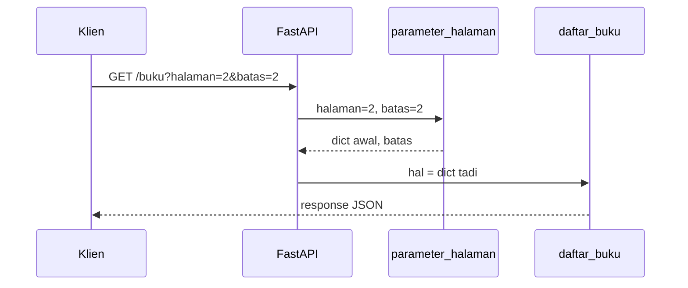

# Konsep Dependency

## Tujuan pembelajaran

Setelah membaca halaman ini, kamu mampu:

- [ ] Menjelaskan apa itu dependency dan dependency injection dengan bahasa sendiri.
- [ ] Mengenali kode berulang yang cocok dijadikan dependency.
- [ ] Membuat dependency berupa fungsi dan memasangnya dengan `Depends`.
- [ ] Menyimpan `Annotated[..., Depends(...)]` dalam alias agar bisa dipakai ulang.
- [ ] Menjelaskan bahwa FastAPI memanggil dependency pada setiap request, dan bahwa aturan validasinya ikut berlaku.

## Prasyarat

- Selesai [Modul 04: Penanganan Error](../04-penanganan-error/index.md).
- Pernah memakai `Query` dengan `Annotated`, seperti di [Validasi Path dan Query Parameter](../03-data-validasi/validasi-path-query.md).

!!! info "Versi yang diuji"
    Kode dan output di halaman ini dijalankan dengan **Python 3.14.7** dan **FastAPI 0.162.0** di Windows. Daftar lengkap versi ada di [Versi yang dipakai di materi ini](../01-pengenalan/instalasi-dan-venv.md#versi-yang-dipakai-di-materi-ini). Versi lain dan sistem operasi lain **belum diuji**.

## Konsep

### Masalah: kode yang diulang

Lihat dua endpoint berikut. Keduanya memakai paginasi yang sama, dengan parameter `halaman` dan `batas`:

```python title="main_berulang.py"
--8<-- "fastapi/05-dependency-injection/konsep-dependency/main_berulang.py"
```

Aturan `ge=1` dan `le=50` ditulis dua kali, begitu juga rumus `awal`. Bayangkan sepuluh endpoint: mengubah batas maksimum menjadi 100 berarti mengubah sepuluh tempat, dan satu tempat yang terlewat membuat perilakunya tidak konsisten.

### Dependency: bahan yang disiapkan di luar

**Dependency** (ketergantungan) adalah sesuatu yang dibutuhkan sebuah endpoint untuk bekerja, dan yang disiapkan oleh pihak lain. Di FastAPI, dependency berupa **fungsi** yang menerima parameter seperti fungsi endpoint, lalu mengembalikan nilai. Endpoint cukup menyatakan "saya butuh ini", dan FastAPI yang menjalankan fungsi tersebut lalu menyerahkan hasilnya.

Itulah **dependency injection** (penyuntikan dependency): endpoint tidak membuat atau memanggil bahannya sendiri, tetapi menerimanya dari luar. Menurut dokumentasi FastAPI, pola ini cocok untuk logika bersama, koneksi basis data, keamanan dan autentikasi, serta integrasi dengan layanan lain.

Analogi sederhana: koki tidak berbelanja bahan sendiri untuk setiap pesanan. Bagian pengadaan menyiapkan bahan, dan koki hanya menyatakan kebutuhannya.

## Kode lengkap

Versi dengan dependency (`main.py`):

```python title="main.py"
--8<-- "fastapi/05-dependency-injection/konsep-dependency/main.py"
```

## Penjelasan kode

### Fungsi dependency

```python
def parameter_halaman(
    halaman: Annotated[int, Query(ge=1)] = 1,
    batas: Annotated[int, Query(ge=1, le=50)] = 3,
):
    global jumlah_panggilan
    jumlah_panggilan += 1
    return {"awal": (halaman - 1) * batas, "batas": batas, "panggilan_ke": jumlah_panggilan}
```

- Parameter dependency dideklarasikan seperti parameter endpoint, lengkap dengan `Query` dan aturannya.
- Nilai yang dikembalikan (`dict`) akan diterima endpoint.
- `jumlah_panggilan` hanya penghitung untuk percobaan: ia menunjukkan berapa kali FastAPI menjalankan fungsi ini. Di kode nyata tidak diperlukan.

### Memasang dengan `Depends`

```python
Halaman = Annotated[dict, Depends(parameter_halaman)]


@app.get("/buku")
def daftar_buku(hal: Halaman):
    awal, batas = hal["awal"], hal["batas"]
    return {"data": buku[awal : awal + batas], "panggilan_ke": hal["panggilan_ke"]}
```

- `Depends(parameter_halaman)` menyatakan: "isi parameter ini dengan hasil `parameter_halaman`".
- Tulis **nama fungsi tanpa kurung**. FastAPI yang akan memanggilnya. Menulis `Depends(parameter_halaman())` menyerahkan hasil panggilan, bukan fungsinya.
- Alias `Halaman` menghindari penulisan `Annotated[dict, Depends(...)]` berulang di setiap endpoint. Ini sintaks alias tipe Python biasa, dan menurut dokumentasi FastAPI, tipe tetap terjaga sehingga editor tetap membantu.
- Parameter `halaman` dan `batas` tidak muncul di fungsi endpoint, tetapi tetap menjadi query parameter karena dideklarasikan di dependency.

### Alurnya



## Menjalankan

```powershell
fastapi dev main.py
```

Server berjalan di `http://127.0.0.1:8000`. Jika port 8000 dipakai aplikasi lain, tambahkan `--port 8001` dan sesuaikan URL di bawah.

## Mencoba request

Hasil di bawah dijalankan berurutan dengan `curl.exe` dari keadaan awal server.

```powershell
curl.exe -i http://127.0.0.1:8000/buku
```

```text
HTTP/1.1 200 OK
{"data":["Buku 1","Buku 2","Buku 3"],"panggilan_ke":1}
```

| Request | Status | Isi |
|---|---|---|
| `GET /buku?halaman=2&batas=2` | `200` | `{"data":["Buku 3","Buku 4"],"panggilan_ke":2}` |
| `GET /anggota?halaman=2` | `200` | `{"data":["Anggota 4"],"panggilan_ke":3}` |

`panggilan_ke` naik setiap request, termasuk saat berpindah dari `/buku` ke `/anggota`. Artinya satu fungsi dependency dipakai oleh dua endpoint, dan FastAPI menjalankannya sekali pada **setiap request** (yang diamati di sini adalah satu pemanggilan per request).

### Aturan validasi ikut berlaku

| Request | Status | `loc` pada error |
|---|---|---|
| `GET /buku?halaman=0` | `422` | `["query","halaman"]` (`greater_than_equal`) |
| `GET /anggota?batas=99` | `422` | `["query","batas"]` (`less_than_equal`) |
| `GET /buku?halaman=x` | `422` | `["query","halaman"]` (`int_parsing`) |

Aturan hanya ditulis sekali di dependency, tetapi menjaga semua endpoint yang memakainya. Bentuk error `422` sama persis dengan yang kamu kenal.

### Dokumentasi otomatis

`/openapi.json` mencatat `halaman` dan `batas` sebagai query parameter untuk `/buku` dan `/anggota`. Ini sejalan dengan dokumentasi FastAPI yang menyatakan persyaratan dari dependency ikut masuk skema OpenAPI. Tampilan visual Swagger UI **belum diverifikasi** lewat browser.

### Versi tanpa dependency

Dengan `TestClient`, versi `main_berulang.py` memberi hasil yang sama untuk `GET /buku?halaman=2&batas=2` (`["Buku 3","Buku 4"]`) dan juga `422` untuk `halaman=0`. Perilakunya identik; yang berbeda hanya letak kodenya.

## Kesalahan umum

| Kesalahan | Akibat |
|---|---|
| `Depends(parameter_halaman())` (dengan kurung) | Diuji: `TypeError: {'v': 1} is not a callable object` saat endpoint didefinisikan. Fungsinya sudah dipanggil, lalu hasilnya bukan fungsi. |
| Menaruh parameter dependency di endpoint juga | Parameter dideklarasikan dua kali; salah satunya akan membingungkan. Cukup di dependency. |
| Membuat dependency untuk hal yang dipakai sekali | Menambah lapisan tanpa manfaat. Jadikan dependency bila dipakai berulang atau perlu dipisahkan. |
| Mengira dependency hanya dipanggil sekali selama server hidup | Dipanggil pada setiap request (teruji dengan penghitung `panggilan_ke`). |
| Lupa `return` | Endpoint menerima `None`. Pastikan dependency mengembalikan nilai yang dibutuhkan. Tidak dijalankan di sini. |

## Latihan

1. **Dasar.** Buat dependency `parameter_cari` dengan query `q` opsional (minimal 2 karakter), dan pakai di dua endpoint melalui alias. Apa respons `GET /a?q=x`?
2. **Prediksi.** Pada `main.py`, setelah dua request `GET /buku` dan satu `GET /anggota` dari keadaan baru, berapa `panggilan_ke` pada request ketiga?
3. **Analisis.** Mengapa menulis `Depends(parameter_halaman())` menghasilkan error, sedangkan `Depends(parameter_halaman)` benar?
4. **Refaktor.** Di `main_berulang.py`, bagian mana yang sebaiknya dipindahkan ke dependency?

??? success "Kunci jawaban"
    Jawaban 1 dan 2 dijalankan dengan `TestClient`. Jawaban 3 mengacu pada hasil uji di bagian Kesalahan umum, dan jawaban 4 adalah penalaran.

    ```python
    from typing import Annotated
    from fastapi import Depends, FastAPI, Query

    app = FastAPI()


    def cari(q: Annotated[str | None, Query(min_length=2)] = None):
        return {"q": q}


    Cari = Annotated[dict, Depends(cari)]


    @app.get("/a")
    def a(c: Cari):
        return c


    @app.get("/b")
    def b(c: Cari):
        return {"dari": "b", **c}
    ```

    1. `GET /a?q=x` menghasilkan `422` dengan `type` `string_too_short` dan `loc` `["query","q"]`. `GET /b?q=py` menghasilkan `200` dengan `{"dari":"b","q":"py"}`, dan `GET /a` tanpa `q` menghasilkan `{"q":null}`.
    2. `panggilan_ke` pada request ketiga bernilai `3`. Teruji.
    3. Tanpa kurung, `Depends` menerima fungsi. Dengan kurung, kita memanggil fungsi sendiri dan `Depends` menerima hasilnya (sebuah `dict`), yang bukan fungsi, sehingga FastAPI melaporkan `TypeError`.
    4. Dua parameter `halaman` dan `batas`, beserta rumus `awal`, dipindahkan ke satu dependency seperti `parameter_halaman`.

## Ringkasan

- Dependency adalah fungsi yang menyiapkan sesuatu yang dibutuhkan endpoint.
- Pasang dengan `Depends(nama_fungsi)`, tanpa kurung, dan simpan dalam alias `Annotated` agar mudah dipakai ulang.
- Parameter dependency dideklarasikan seperti parameter endpoint, dengan validasi yang sama, dan tampil di dokumentasi otomatis.
- FastAPI memanggil dependency pada setiap request.
- Ubah di satu tempat, berlaku di semua endpoint yang memakainya.

!!! note "Dependency dan pengujian"
    Salah satu manfaat dependency adalah bisa diganti saat pengujian (*override dependency*), misalnya mengganti basis data asli dengan yang tiruan. Topik itu dibahas di Modul 09, yaitu [Pengujian](../09-pengujian/index.md).

## Langkah berikutnya

Kembali ke daftar materi di [Modul 05: Dependency Injection](index.md). Materi berikutnya adalah dependency sederhana: dependency berupa class dan dependency yang bisa menolak request.
