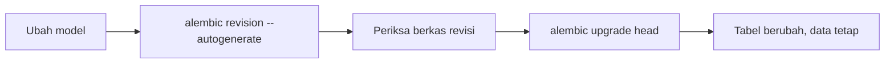

# Migrasi

## Tujuan pembelajaran

Setelah membaca halaman ini, kamu mampu:

- [ ] Menjelaskan mengapa mengubah model tidak cukup untuk mengubah tabel yang sudah berisi data.
- [ ] Menyiapkan Alembic untuk proyek SQLModel.
- [ ] Membuat revisi migrasi otomatis (*autogenerate*) dan memeriksanya sebelum dijalankan.
- [ ] Menjalankan `upgrade` dan `downgrade`, serta membaca `current`, `history`, dan `check`.
- [ ] Mengenali jebakan: kolom wajib tanpa nilai bawaan, migrasi yang setengah jalan, dan `downgrade` yang keliru.

## Prasyarat

- Sudah membaca [Model dan Skema](model-dan-skema.md), terutama bagian "Menambah field tidak mengubah tabel lama".
- Sudah membaca [Operasi CRUD](operasi-crud.md).

!!! info "Versi yang diuji"
    Kode dan output di halaman ini dijalankan dengan **Python 3.14.7**, **FastAPI 0.162.0**, **SQLModel 0.0.48**, **SQLAlchemy 2.1.6**, dan **Alembic 1.20.1** di Windows. Daftar versi lain ada di [Versi yang dipakai di materi ini](../01-pengenalan/instalasi-dan-venv.md#versi-yang-dipakai-di-materi-ini). Versi lain dan sistem operasi lain **belum diuji**.

## Konsep

Di [Model dan Skema](model-dan-skema.md) kita melihat bahwa menambah field ke model tidak mengubah tabel lama: membaca data langsung menghasilkan `no such column`. Menghapus `database.db` memang memecahkannya, tetapi menghapus semua data. Pada aplikasi yang sudah dipakai, itu tidak bisa diterima.

**Migrasi** adalah cara mengubah struktur basis data secara bertahap dan tercatat. Setiap perubahan ditulis sebagai satu **revisi**: sebuah berkas Python berisi langkah `upgrade` (menerapkan perubahan) dan `downgrade` (membatalkannya). Basis data mengingat revisi terakhir yang diterapkan, sehingga perubahan hanya dijalankan sekali dan berurutan.

**Alembic** adalah alat migrasi untuk SQLAlchemy, dan SQLModel dibangun di atasnya. Dokumentasi FastAPI juga menunjuk Alembic untuk migrasi produksi, dan menyebut membuat tabel saat startup (`create_all`) sebagai penyederhanaan.

Alur kerjanya:



## Pemasangan

Alembic belum terpasang bersama SQLModel. Dengan venv aktif:

```powershell
pip install alembic
```

## Struktur contoh

Contoh lengkap ada di `examples/fastapi/06-basis-data/migrasi/`:

| Berkas | Fungsi |
|---|---|
| `models.py` | Model tabel (versi akhir) |
| `main.py` | Aplikasi FastAPI, **tanpa** `create_all` |
| `alembic.ini` | Konfigurasi Alembic, termasuk alamat basis data |
| `alembic/env.py` | Menghubungkan Alembic ke model |
| `alembic/script.py.mako` | Templat berkas revisi |
| `alembic/versions/` | Berkas revisi, satu per perubahan |

## Langkah demi langkah

### Langkah 1: inisialisasi

Di folder proyek:

```powershell
alembic init alembic
```

Perintah ini membuat `alembic.ini` dan folder `alembic/` (`env.py`, `script.py.mako`, `versions/`). Di contoh ini isinya sudah disiapkan.

### Langkah 2: arahkan ke basis data

Di `alembic.ini`, ganti alamat bawaan:

```ini
sqlalchemy.url = sqlite:///database.db
```

### Langkah 3: hubungkan ke model

Di `alembic/env.py`, ganti `target_metadata = None` dengan:

```python
from sqlmodel import SQLModel

import models  # noqa: F401  (agar model terdaftar di metadata)

target_metadata = SQLModel.metadata
```

`import models` memastikan kelas tabel sudah dimuat, supaya `SQLModel.metadata` mengetahui tabelnya. Dengan `target_metadata`, Alembic bisa membandingkan model dengan basis data dan menyusun revisi otomatis.

### Langkah 4: tambahkan `import sqlmodel` di templat

Di `alembic/script.py.mako`, tepat di bawah `import sqlalchemy as sa`, tambahkan:

```python
import sqlmodel
```

Revisi yang dihasilkan memakai tipe `sqlmodel.sql.sqltypes.AutoString()` untuk kolom teks. Berkas revisi dibuat dari templat ini; tanpa impor tersebut, berkas yang memakai `sqlmodel.sql.sqltypes.AutoString()` tidak punya nama `sqlmodel` untuk dipakai. (Kegagalan tanpa impor ini tidak diuji; di contoh, impor sudah ada.)

### Langkah 5: revisi pertama

Model awal (`models.py` versi 1):

```python
from sqlmodel import Field, SQLModel


class Tugas(SQLModel, table=True):
    id: int | None = Field(default=None, primary_key=True)
    judul: str = Field(min_length=3, max_length=100)
    selesai: bool = False
```

Buat revisi otomatis lalu jalankan:

```powershell
alembic revision --autogenerate -m "buat tabel tugas"
alembic upgrade head
```

Pesan penting dari Alembic:

```text
Detected added table 'tugas'
Running upgrade  -> 6e5b10db2a3c, buat tabel tugas
```

Berkas revisi `alembic/versions/6e5b10db2a3c_buat_tabel_tugas.py` berisi `op.create_table('tugas', ...)` pada `upgrade()` dan `op.drop_table('tugas')` pada `downgrade()`. Basis data kini memiliki tabel `tugas` dan tabel `alembic_version` yang menyimpan nomor revisi terakhir (`6e5b10db2a3c`).

Misalkan sudah ada satu baris data:

```text
(1, 'Tugas lama', 0)
```

### Langkah 6: ubah model

Tambahkan dua kolom ke `models.py` (inilah versi akhir di contoh):

```python title="models.py"
--8<-- "fastapi/06-basis-data/migrasi/models.py"
```

Buat revisi:

```powershell
alembic revision --autogenerate -m "tambah catatan dan prioritas"
```

```text
Detected added column 'tugas.catatan'
Detected added column 'tugas.prioritas'
```

### Langkah 7: periksa dan perbaiki revisi

Jangan langsung menjalankan revisi yang dihasilkan otomatis. Alembic sendiri menandai isinya dengan komentar `please adjust!` (silakan sesuaikan). Berkas yang dihasilkan untuk `upgrade()`:

```python
op.add_column('tugas', sa.Column('catatan', sqlmodel.sql.sqltypes.AutoString(), nullable=True))
op.add_column('tugas', sa.Column('prioritas', sa.Integer(), nullable=False))
```

Masalah: `prioritas` wajib terisi (`nullable=False`), padahal baris lama belum punya nilainya. Perbaiki dengan nilai bawaan di sisi basis data (`server_default`):

```python
op.add_column('tugas', sa.Column('prioritas', sa.Integer(), server_default='2', nullable=False))
```

Berkas revisi final di contoh:

```python title="alembic/versions/583a9422fc6c_tambah_catatan_dan_prioritas.py"
--8<-- "fastapi/06-basis-data/migrasi/alembic/versions/583a9422fc6c_tambah_catatan_dan_prioritas.py"
```

### Langkah 8: jalankan

```powershell
alembic upgrade head
```

```text
Running upgrade 6e5b10db2a3c -> 583a9422fc6c, tambah catatan dan prioritas
```

Data lama aman, dan baris lama mendapat nilai bawaan:

```text
(1, 'Tugas lama', 0, None, 2)
```

Kolom urutannya: `id`, `judul`, `selesai`, `catatan`, `prioritas`. Baris lama punya `catatan` kosong dan `prioritas` 2.

### Langkah 9: aplikasi memakai skema baru

`main.py` di contoh ini tidak memanggil `create_all`:

```python title="main.py"
--8<-- "fastapi/06-basis-data/migrasi/main.py"
```

Tabel sepenuhnya diurus Alembic. Jalankan dengan `fastapi dev main.py`. Hasil `curl`:

```powershell
curl.exe http://127.0.0.1:8000/tugas
```

```json
[{"judul":"Tugas lama","selesai":false,"prioritas":2,"id":1,"catatan":null}]
```

`POST /tugas` dengan `{"judul":"Tugas baru","catatan":"Sesudah migrasi","prioritas":1}` menghasilkan `201`:

```json
{"judul":"Tugas baru","selesai":false,"prioritas":1,"id":2,"catatan":"Sesudah migrasi"}
```

Catatan: `main.py` ini memakai model tabel `Tugas` langsung sebagai body dan response demi singkat. Di kode nyata, pisahkan skema seperti di [Model dan Skema](model-dan-skema.md).

## Perintah yang perlu dikenal

Hasil nyata dari contoh di atas:

| Perintah | Fungsi | Hasil |
|---|---|---|
| `alembic current` | Revisi yang sedang diterapkan | `583a9422fc6c (head)` |
| `alembic history` | Daftar revisi | `6e5b10db2a3c -> 583a9422fc6c (head), tambah catatan dan prioritas` dan `<base> -> 6e5b10db2a3c, buat tabel tugas` |
| `alembic check` | Apakah model dan basis data sudah sama | `No new upgrade operations detected.` |
| `alembic upgrade head` | Terapkan semua revisi hingga yang terbaru | seperti di atas |
| `alembic downgrade -1` | Batalkan satu revisi dari posisi sekarang | lihat di bawah |

Jika model diubah tetapi revisi belum dibuat, `alembic check` gagal:

```text
FAILED: New upgrade operations detected: [('add_column', None, 'tugas', Column('tenggat', AutoString(), ...))]
```

### `downgrade`

`alembic downgrade -1` membatalkan revisi terakhir. Di contoh, ini menghapus kolom `catatan` dan `prioritas`:

```text
Running downgrade 583a9422fc6c -> 6e5b10db2a3c, tambah catatan dan prioritas
(1, 'Tugas lama', 0)
```

Baris tetap ada, tetapi kolom yang dihapus ikut hilang bersama isinya. Setelah `upgrade` lagi, kolom itu kembali dengan nilai awal: pada percobaan, baris lama kembali menjadi `(1, 'Tugas lama', 0, None, 2)`, yaitu `prioritas` 2 dari nilai bawaan. Nilai yang pernah diisi sendiri di kolom tersebut tidak otomatis kembali (ini penalaran dari penghapusan kolom, tidak diuji dengan data terisi).

## Jebakan yang teramati

### 1. Kolom wajib tanpa nilai bawaan

Menjalankan revisi sebelum diperbaiki (Langkah 7) menghasilkan:

```text
sqlite3.OperationalError: Cannot add a NOT NULL column with default value NULL
```

### 2. Migrasi setengah jalan

Pada percobaan yang sama, kolom `catatan` **sudah sempat ditambahkan** sebelum `prioritas` gagal, sementara nomor revisi di `alembic_version` tetap yang lama. Alembic mencatat `Will assume non-transactional DDL` untuk SQLite, yang berarti perubahan struktur tidak dibatalkan otomatis saat salah satu langkah gagal. Menjalankan `upgrade` lagi setelah memperbaiki berkas menghasilkan:

```text
sqlite3.OperationalError: duplicate column name: catatan
```

Karena kolom `catatan` sudah ada. Pemulihan yang kami lakukan dalam percobaan adalah mulai ulang dari awal pada basis data uji. Untuk data nyata, cadangkan `database.db` sebelum migrasi dan perbaiki revisi sebelum dijalankan.

### 3. `downgrade -1` dari posisi yang keliru

Pada percobaan yang sama, `alembic downgrade -1` dijalankan saat revisi tercatat masih yang pertama. Hasilnya `Running downgrade 6e5b... -> `: tabel `tugas` **dihapus**, bersama datanya. `-1` berarti "mundur satu langkah dari posisi saat ini", bukan "batalkan revisi terakhir yang ditulis". Selalu periksa `alembic current` sebelum `downgrade`.

## Kesalahan umum

| Kesalahan | Akibat |
|---|---|
| Menjalankan revisi autogenerate tanpa membacanya | Kolom wajib tanpa nilai bawaan gagal (teruji). Baca dan perbaiki dulu. |
| Memakai `create_all` dan Alembic bersamaan | Tabel bisa dibuat di luar catatan migrasi. Pilih satu cara; `main.py` di contoh tidak memakai `create_all`. |
| Lupa `import models` di `env.py` | Alembic tidak melihat tabel apa pun, sehingga revisi kosong. Tidak dijalankan di sini. |
| Lupa `import sqlmodel` di templat revisi | Revisi yang memakai `AutoString` tidak bisa dijalankan. Tidak dijalankan di sini. |
| Mengedit revisi lama yang sudah diterapkan | Basis data lain tidak ikut berubah. Buat revisi baru. |
| Tidak mencadangkan data sebelum `downgrade` | Data di kolom yang dihapus hilang (teruji). |
| Mengirim `database.db` ke Git | Berisi data. Berkas `*.db` diabaikan lewat `.gitignore` repositori ini. |

## Latihan

1. **Dasar.** Mengapa `create_all` tidak cukup untuk menambah kolom ke tabel yang sudah ada?
2. **Praktik.** Tambahkan `tenggat: str | None = None` ke model. Apa hasil `alembic check`, lalu buat dan jalankan revisinya.
3. **Prediksi.** Apa yang berubah pada data lama setelah `upgrade` untuk `tenggat`? Dan setelah `downgrade -1`?
4. **Analisis.** Mengapa kolom wajib baru butuh `server_default`?

??? success "Kunci jawaban"
    Jawaban 2 dan 3 dijalankan dengan Alembic pada basis data uji. Jawaban 1 dan 4 mengacu pada hasil di halaman ini.

    1. `create_all` hanya membuat tabel yang belum ada. Menambah kolom ke tabel lama menghasilkan `no such column` (teruji di [Model dan Skema](model-dan-skema.md)).
    2. `alembic check` gagal dengan `New upgrade operations detected: [('add_column', None, 'tugas', Column('tenggat', ...))]`. Lalu `alembic revision --autogenerate -m "tambah tenggat"` mendeteksi `Detected added column 'tugas.tenggat'`, dengan `upgrade()` berisi `op.add_column('tugas', sa.Column('tenggat', ..., nullable=True))`. `alembic upgrade head` menerapkannya.
    3. Setelah `upgrade`, baris lama mendapat `tenggat` kosong (`None`), contohnya `(1, 'Tugas lama', 0, None, 2, None)`. Setelah `downgrade -1`, kolom `tenggat` hilang dan baris kembali berisi lima kolom.
    4. Baris lama belum punya nilai untuk kolom itu. Kolom wajib tanpa nilai bawaan ditolak SQLite dengan `Cannot add a NOT NULL column with default value NULL`; `server_default` memberi nilai awal bagi baris lama.

## Ringkasan

- Migrasi mengubah struktur basis data secara bertahap dan tercatat, tanpa menghapus data.
- Alembic menyimpan revisi sebagai berkas Python dengan `upgrade` dan `downgrade`; nomor revisi terakhir disimpan di tabel `alembic_version`.
- Untuk SQLModel, hubungkan `target_metadata = SQLModel.metadata` dan tambahkan `import sqlmodel` di templat revisi.
- Autogenerate adalah draf: periksa dan perbaiki (misalnya `server_default`) sebelum `upgrade`.
- `current`, `history`, dan `check` membantu memeriksa keadaan; periksa `current` sebelum `downgrade`.
- SQLite tidak membatalkan perubahan struktur otomatis saat migrasi gagal di tengah; cadangkan data.

## Langkah berikutnya

Lanjut ke [Proyek Praktik Tahap 3](proyek-tahap-3.md), atau kembali ke daftar materi di [Modul 06: Basis Data](index.md).
