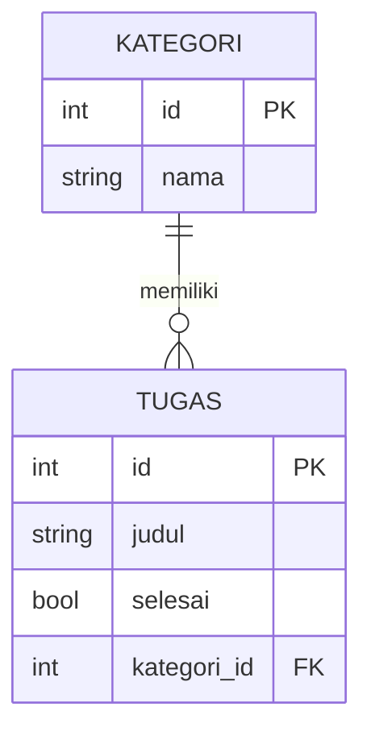

# Relasi

## Tujuan pembelajaran

Setelah membaca halaman ini, kamu mampu:

- [ ] Menjelaskan relasi satu-ke-banyak dan peran *foreign key*.
- [ ] Mendeklarasikan relasi dengan `foreign_key` dan `Relationship(back_populates=...)`.
- [ ] Membuat skema output yang menyertakan data terkait tanpa terjebak lingkaran tak berujung.
- [ ] Memeriksa sendiri keberadaan data induk sebelum menyimpan data anak.
- [ ] Menolak penghapusan data induk yang masih memiliki anak.
- [ ] Menegakkan foreign key dan keunikan di tingkat basis data (`PRAGMA`, `unique`, `index`).

## Prasyarat

- Sudah membaca [Operasi CRUD](operasi-crud.md).

!!! info "Versi yang diuji"
    Kode dan output di halaman ini dijalankan dengan **Python 3.14.7**, **FastAPI 0.162.0**, **SQLModel 0.0.48**, dan **SQLAlchemy 2.1.6** di Windows. Daftar versi lain ada di [Versi yang dipakai di materi ini](../01-pengenalan/instalasi-dan-venv.md#versi-yang-dipakai-di-materi-ini). Versi lain dan sistem operasi lain **belum diuji**.

## Konsep

Sebuah tugas biasanya masuk dalam satu kategori (misalnya "Kuliah" atau "Rumah"), dan satu kategori punya banyak tugas. Itu **relasi satu-ke-banyak** (*one-to-many*).



Di basis data, relasi disimpan lewat **foreign key** (kunci asing): kolom `kategori_id` di tabel `tugas` berisi `id` kategori pemiliknya. Tabel yang memegang kolom itu adalah sisi "banyak".

SQLModel menambah satu hal lagi: **`Relationship`**, yaitu atribut Python yang memungkinkan kamu menulis `tugas.kategori` atau `kategori.tugas` tanpa menulis `JOIN` sendiri. Atribut ini bukan kolom; ia tidak muncul di tabel.

## Kode lengkap

Simpan sebagai `main.py`:

```python title="main.py"
--8<-- "fastapi/06-basis-data/relasi/main.py"
```

## Penjelasan kode

### Foreign key di sisi "banyak"

```python
class TugasDasar(SQLModel):
    judul: str = Field(min_length=3, max_length=100)
    selesai: bool = False
    kategori_id: int | None = Field(default=None, foreign_key="kategori.id")
```

- `foreign_key="kategori.id"` menyatakan bahwa kolom ini merujuk ke kolom `id` di tabel `kategori`. Nama tabel `kategori` berasal dari nama kelas `Kategori` dalam huruf kecil.
- `int | None` dengan default `None` membuat kategori bersifat opsional: tugas boleh tanpa kategori.
- Field ini ada di kelas dasar, sehingga muncul di tabel, skema input, dan skema output.

### Relationship di kedua sisi

```python
class Kategori(KategoriDasar, table=True):
    id: int | None = Field(default=None, primary_key=True)
    tugas: list["Tugas"] = Relationship(back_populates="kategori")


class Tugas(TugasDasar, table=True):
    id: int | None = Field(default=None, primary_key=True)
    kategori: Kategori | None = Relationship(back_populates="tugas")
```

- `Kategori.tugas` berisi daftar tugas milik kategori itu. `Tugas.kategori` berisi kategori pemilik tugas itu.
- `back_populates` menghubungkan keduanya: nama atribut di sisi lain. Menurut dokumentasi SQLModel, kedua sisi saling menunjuk.
- `"Tugas"` ditulis dalam tanda kutip karena kelas `Tugas` belum didefinisikan saat `Kategori` ditulis.

### Skema output dengan data terkait

```python
class TugasDenganKategori(TugasPublik):
    kategori: KategoriPublik | None = None


class KategoriDenganTugas(KategoriPublik):
    tugas: list[TugasPublik] = []
```

Skema dasar (`TugasPublik`, `KategoriPublik`) tidak memuat relasi, sehingga daftar biasa tetap ringan. Dua skema tambahan khusus untuk endpoint yang memang butuh data terkait. Perhatikan bahwa keduanya merujuk skema **sederhana** di sisi lain: `TugasDenganKategori` memakai `KategoriPublik`, dan `KategoriDenganTugas` memakai `TugasPublik`. Menurut dokumentasi SQLModel, jika kedua sisi saling memuat penuh, hasilnya lingkaran tak berujung (kategori memuat tugas yang memuat kategori yang memuat tugas, dan seterusnya) dan dapat memicu error rekursi.

### Memeriksa data induk

```python
if data.kategori_id is not None and session.get(Kategori, data.kategori_id) is None:
    raise HTTPException(status_code=404, detail="Kategori tidak ditemukan")
```

Sebelum menyimpan tugas, kita periksa sendiri apakah kategorinya ada. Alasannya dibuktikan di bagian [Temuan](#temuan-sqlite-tidak-menolak-kategori-yang-tidak-ada) di bawah.

### Menghapus induk

```python
if kategori.tugas:
    raise HTTPException(status_code=409, detail="Kategori masih memiliki tugas")
```

`kategori.tugas` memuat tugas anak. Bila ada, hapus ditolak dengan `409`. Tanpa pemeriksaan ini, tugas akan "yatim piatu": `kategori_id`-nya merujuk kategori yang sudah tidak ada.

## Menjalankan

```powershell
pip install sqlmodel
fastapi dev main.py
```

Server berjalan di `http://127.0.0.1:8000`. Jika port 8000 dipakai aplikasi lain, tambahkan `--port 8001` dan sesuaikan URL di bawah. Berkas `database.db` dibuat di folder kerja.

## Mencoba request

Hasil di bawah dijalankan berurutan dengan `curl.exe` dari keadaan tanpa `database.db`.

### Membuat data

| Request | Status | Isi |
|---|---|---|
| `POST /kategori` `{"nama":"Kuliah"}` | `201` | `{"nama":"Kuliah","id":1}` |
| `POST /kategori` `{"nama":"Rumah"}` | `201` | `{"nama":"Rumah","id":2}` |
| `POST /tugas` `{"judul":"Kerjakan modul 06","kategori_id":1}` | `201` | `{"judul":"Kerjakan modul 06","selesai":false,"kategori_id":1,"id":1}` |
| `POST /tugas` `{"judul":"Baca jurnal","kategori_id":1}` | `201` | tugas `id` 2 |
| `POST /tugas` `{"judul":"Tanpa kategori"}` | `201` | `"kategori_id":null`, `id` 3 |
| `POST /tugas` `{"judul":"Kategori hantu","kategori_id":99}` | `404` | `{"detail":"Kategori tidak ditemukan"}` |

### Membaca dengan relasi

`GET /kategori/1` memuat daftar tugasnya:

```json
{"nama":"Kuliah","id":1,"tugas":[{"judul":"Kerjakan modul 06","selesai":false,"kategori_id":1,"id":1},{"judul":"Baca jurnal","selesai":false,"kategori_id":1,"id":2}]}
```

| Request | Status | Isi |
|---|---|---|
| `GET /kategori/2` | `200` | `{"nama":"Rumah","id":2,"tugas":[]}` |
| `GET /kategori/99` | `404` | `{"detail":"Kategori tidak ditemukan"}` |
| `GET /tugas/1` | `200` | tugas dengan `"kategori":{"nama":"Kuliah","id":1}` |
| `GET /tugas/3` | `200` | `"kategori":null` |
| `GET /tugas?kategori_id=1` | `200` | hanya tugas 1 dan 2, tanpa objek `kategori` |

`GET /tugas` biasa memakai `TugasPublik`, sehingga tidak memuat objek `kategori`. Hanya `GET /tugas/{id}` yang memakai `TugasDenganKategori`.

### Menghapus induk

| Request | Status | Isi |
|---|---|---|
| `DELETE /kategori/1` | `409` | `{"detail":"Kategori masih memiliki tugas"}` |
| `DELETE /kategori/2` | `204` | tanpa isi (kategori kosong) |

### Temuan: SQLite tidak menolak kategori yang tidak ada

Diuji dengan skrip terpisah yang menyimpan `Tugas(judul="Yatim piatu", kategori_id=99)` langsung lewat session, tanpa pemeriksaan di endpoint. Hasilnya:

```text
tersimpan: 99 kategori: None
```

Baris tersimpan tanpa error walau kategori `99` tidak ada, dan `tugas.kategori` bernilai `None`. Artinya pada pengaturan yang kita pakai, `foreign_key` di model tidak otomatis membuat SQLite menegakkan aturan itu. Karena itu pemeriksaan di endpoint (`404`) diperlukan. Bagian berikutnya menunjukkan cara membuat basis data sendiri ikut menegakkannya. Basis data server seperti PostgreSQL berperilaku berbeda dari SQLite, tetapi itu tidak diuji di sini.

### Menegakkan aturan di tingkat basis data

Pemeriksaan di endpoint melindungi lewat API, tetapi data bisa juga masuk lewat jalan lain (skrip, migrasi, alat basis data). Karena itu aturan penting sebaiknya juga ditegakkan oleh basis data. Contoh lengkap ada di `aturan_basis_data.py`:

```python title="aturan_basis_data.py"
--8<-- "fastapi/06-basis-data/relasi/aturan_basis_data.py"
```

Tiga hal yang ditunjukkan:

- **Foreign key aktif.** SQLite hanya menegakkan foreign key bila `PRAGMA foreign_keys=ON` dijalankan pada setiap koneksi baru. Hook `@event.listens_for(engine, "connect")` melakukannya otomatis.
- **`unique=True`.** `Field(unique=True)` menambah batasan keunikan pada kolom.
- **`index=True`.** `Field(index=True)` membuat indeks untuk mempercepat pencarian pada kolom itu. Pada contoh, `unique=True` dan `index=True` bersama menghasilkan satu indeks unik bernama `ix_kategori_nama`.

Hasil menjalankan skrip:

```text
kategori_id=99 -> IntegrityError: FOREIGN KEY constraint failed
nama kembar -> IntegrityError: UNIQUE constraint failed: kategori.nama
data valid -> tersimpan
indeks kategori: [('ix_kategori_nama', 1)]
```

Kini baris dengan `kategori_id` 99 dan nama kategori kembar ditolak oleh basis data dengan `IntegrityError`. Dalam aplikasi, pelanggaran seperti ini perlu ditangkap dan diubah menjadi `409` atau `404` (seperti di [Handler Error Kustom](../04-penanganan-error/handler-kustom.md)); bila tidak, klien menerima `500`, seperti temuan di [Koneksi ke Basis Data](koneksi-basis-data.md). Pemeriksaan di endpoint tetap berguna karena memberi pesan yang jelas.

Mengubah `unique` atau `index` pada tabel yang sudah ada juga butuh [migrasi](migrasi.md); contoh skrip ini membuat basis data baru.

### Skema di dokumentasi otomatis

`/openapi.json` memuat skema `KategoriBuat`, `KategoriPublik`, `KategoriDenganTugas`, `TugasBuat`, `TugasPublik`, dan `TugasDenganKategori`. Tabel `Kategori` dan `Tugas` tidak muncul. Tampilan visual Swagger UI **belum diverifikasi** lewat browser.

## Kesalahan umum

| Kesalahan | Akibat |
|---|---|
| Mengandalkan `foreign_key` untuk menolak induk yang tidak ada | Tanpa `PRAGMA foreign_keys=ON`, SQLite menyimpan `kategori_id` 99 tanpa error (teruji). Aktifkan PRAGMA dan/atau periksa sendiri. |
| Menaruh relasi penuh di kedua sisi skema output | Lingkaran tak berujung (dokumentasi SQLModel); gunakan skema sederhana di sisi dalam. |
| Menulis `list[Tugas]` tanpa tanda kutip di `Kategori` | Kelas `Tugas` belum ada saat `Kategori` didefinisikan. Tulis `list["Tugas"]`. Tidak dijalankan di sini. |
| Lupa `back_populates` | Dua sisi tidak saling terhubung. Tidak dijalankan di sini. |
| Menghapus induk tanpa memeriksa anak | Anak menunjuk induk yang tidak ada (teruji lewat skrip `kategori_id=99`; efeknya sama). |
| Memakai skema dengan relasi untuk daftar panjang | Setiap baris membawa data terkait, sehingga boros. Pakai skema sederhana untuk daftar. |
| Mengira `Relationship` adalah kolom | Bukan; ia atribut Python dan tidak ada di tabel. |

## Latihan

1. **Dasar.** Pada diagram, kolom mana yang menjadi *foreign key*, dan di tabel mana?
2. **Prediksi.** Apa isi `GET /tugas/3` dan mengapa `kategori` bernilai `null`?
3. **Praktik.** Tambahkan `GET /kategori` yang mengembalikan daftar kategori tanpa tugas. Skema mana yang dipakai?
4. **Analisis.** Mengapa `KategoriDenganTugas` memakai `TugasPublik`, bukan `TugasDenganKategori`?

??? success "Kunci jawaban"
    Jawaban 2 mengacu pada hasil uji di atas. Jawaban lain adalah penalaran dari kode dan dokumentasi SQLModel; jawaban 3 tidak dijalankan.

    1. `kategori_id`, di tabel `tugas`.
    2. `kategori_id` tugas 3 adalah `null`, jadi tidak ada kategori yang terkait: `"kategori":null` (teruji).
    3. Pakai `KategoriPublik`:

        ```python
        @app.get("/kategori", response_model=list[KategoriPublik])
        def daftar_kategori(session: SessionDep):
            return session.exec(select(Kategori)).all()
        ```

    4. Bila memakai `TugasDenganKategori`, setiap tugas membawa kategorinya, yang membawa tugas lagi, dan seterusnya: lingkaran tak berujung. Skema sederhana di sisi dalam memutus lingkaran itu.

## Ringkasan

- Relasi satu-ke-banyak disimpan lewat *foreign key* di sisi "banyak".
- `foreign_key="kategori.id"` menyatakan kolom, `Relationship(back_populates=...)` memberi akses objek terkait.
- Skema output dengan relasi ditulis terpisah dan memakai skema sederhana di sisi dalam agar tidak melingkar.
- SQLite tidak menolak kategori yang tidak ada pada pengaturan ini, jadi periksa di endpoint.
- Tolak penghapusan induk yang masih punya anak dengan `409`.
- Agar basis data ikut menegakkan aturan: aktifkan `PRAGMA foreign_keys=ON` di SQLite, dan pakai `unique=True` serta `index=True` pada kolom.

## Langkah berikutnya

Lanjut ke [Migrasi](migrasi.md), atau kembali ke daftar materi di [Modul 06: Basis Data](index.md).
