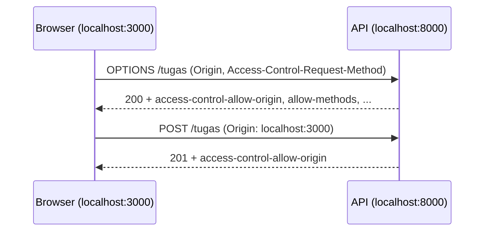

# CORS

## Tujuan pembelajaran

Setelah membaca halaman ini, kamu mampu:

- [ ] Menjelaskan apa itu *origin* dan mengapa browser memberlakukan aturan CORS.
- [ ] Menjelaskan *preflight request* (`OPTIONS`).
- [ ] Memasang `CORSMiddleware` dengan `allow_origins`, `allow_methods`, dan `allow_headers`.
- [ ] Membaca header `access-control-*` pada response untuk menilai konfigurasi.
- [ ] Menjelaskan bahwa CORS **bukan** pengaman akses di sisi server.
- [ ] Mengatur `allow_credentials=True` dengan origin eksplisit, dan mengenali bahayanya bila digabung dengan `"*"`.

## Prasyarat

- Sudah membaca [Proteksi Endpoint](proteksi-endpoint.md) dan [Otorisasi](otorisasi.md).
- Pemahaman dasar request dan response HTTP dari [HTTP dan REST](../01-pengenalan/http-dan-rest.md).

!!! info "Versi yang diuji"
    Kode dan output di halaman ini dijalankan dengan **Python 3.14.7** dan **FastAPI 0.162.0** (dengan Starlette 1.10.0) di Windows. Daftar versi lain ada di [Versi yang dipakai di materi ini](../01-pengenalan/instalasi-dan-venv.md#versi-yang-dipakai-di-materi-ini). Versi lain dan sistem operasi lain **belum diuji**.

!!! warning "Keterbatasan pengujian"
    CORS dijalankan oleh **browser**. Tidak ada browser yang dipakai di halaman ini, jadi perilaku sisi browser (misalnya pesan galat di konsol) **tidak diuji**. Yang diuji adalah header yang dikirim server, dengan `curl` yang meniru request browser.

## Konsep

### Origin

**Origin** adalah kombinasi tiga hal: protokol, domain, dan port. Menurut dokumentasi FastAPI, perbedaan pada salah satunya berarti origin yang berbeda, misalnya:

- `http://localhost`
- `https://localhost`
- `http://localhost:8080`

### Masalah yang diatur CORS

Bayangkan frontend di `http://localhost:3000` (aplikasi web) memanggil API di `http://localhost:8000` lewat JavaScript. Keduanya origin berbeda. Secara bawaan, browser **tidak membiarkan** JavaScript membaca response dari origin lain, kecuali server menyatakan izinnya lewat header khusus. Aturan ini disebut **CORS** (*Cross-Origin Resource Sharing*).

Dua hal penting:

1. **Browser yang menegakkannya**, bukan server. Server hanya mengirim header yang menyatakan origin mana yang diizinkan.
2. CORS hanya relevan bila request berasal dari JavaScript di browser. `curl`, aplikasi ponsel, atau server lain tidak terpengaruh.

### Preflight

Untuk request yang berpotensi mengubah data atau memakai header khusus (misalnya `Authorization`), browser lebih dulu mengirim request `OPTIONS` yang disebut **preflight**: "bolehkah saya mengirim `POST` dengan header ini dari origin ini?". Bila server mengizinkan, baru request sebenarnya dikirim. `CORSMiddleware` menjawab preflight itu otomatis.



## Kode lengkap

Simpan sebagai `main.py`:

```python title="main.py"
--8<-- "fastapi/07-autentikasi-keamanan/cors/main.py"
```

## Penjelasan kode

```python
app.add_middleware(
    CORSMiddleware,
    allow_origins=origin_diizinkan,
    allow_methods=["GET", "POST"],
    allow_headers=["Authorization", "Content-Type"],
    allow_credentials=False,
    max_age=600,
)
```

`add_middleware` memasang `CORSMiddleware` pada seluruh aplikasi. Parameternya (menurut dokumentasi FastAPI):

| Parameter | Arti |
|---|---|
| `allow_origins` | Daftar origin yang diizinkan. `["*"]` berarti semua origin. |
| `allow_methods` | Method HTTP yang diizinkan untuk request lintas origin. Bawaannya hanya `GET`. |
| `allow_headers` | Header request yang diizinkan. Bawaannya kosong. Beberapa header dasar (`Accept`, `Content-Type`, dan sejenisnya) selalu diizinkan untuk request sederhana. |
| `allow_credentials` | Apakah cookie dan kredensial boleh dikirim lintas origin. Bawaan `False`. |
| `max_age` | Lama (detik) browser boleh menyimpan hasil preflight. Bawaan 600. |

Dua aturan dari dokumentasi FastAPI:

- `"*"` pada `allow_origins` hanya mengizinkan request **tanpa kredensial** (cookie, header `Authorization` seperti token Bearer). Untuk request berkredensial, sebutkan origin satu per satu.
- `allow_origins`, `allow_methods`, dan `allow_headers` tidak boleh `["*"]` bila `allow_credentials=True`. Semuanya harus disebut eksplisit.

Pengaturan bawaan middleware ketat; kamu harus mengaktifkan origin, method, dan header yang dibutuhkan secara eksplisit. Daftar `origin_diizinkan` di contoh berisi dua origin fiktif untuk frontend: yang kamu masukkan di aplikasi nyata adalah alamat frontend aslimu.

## Menjalankan

```powershell
fastapi dev main.py
```

Server berjalan di `http://127.0.0.1:8000`. Jika port 8000 dipakai aplikasi lain, tambahkan `--port 8001` dan sesuaikan URL di bawah.

## Mencoba request

Tanpa browser, kita meniru browser dengan `curl.exe`: header `Origin` ditambahkan sendiri, dan preflight dikirim dengan method `OPTIONS`. Di bawah hanya baris status dan header `access-control-*` yang ditampilkan.

### Request biasa

```powershell
curl.exe -i -H "Origin: http://localhost:3000" http://127.0.0.1:8000/tugas
```

| Origin pengirim | Status | Header `access-control-allow-origin` |
|---|---|---|
| (tidak ada) | `200` | tidak ada |
| `http://localhost:3000` (diizinkan) | `200` | `http://localhost:3000` |
| `http://jahat.example.com` (tidak diizinkan) | `200` | **tidak ada** |

Isi response selalu `[{"id":1,"judul":"Belajar CORS"}]`. Server tetap menjawab `200` untuk origin yang tidak diizinkan; bedanya hanya header izin tidak ikut. **Browser** yang kemudian menolak memberikan isinya kepada JavaScript pada origin itu.

### Preflight

```powershell
curl.exe -i -X OPTIONS -H "Origin: http://localhost:3000" -H "Access-Control-Request-Method: POST" -H "Access-Control-Request-Headers: Authorization" http://127.0.0.1:8000/tugas
```

```text
HTTP/1.1 200 OK
access-control-allow-methods: GET, POST
access-control-max-age: 600
access-control-allow-headers: Accept, Accept-Language, Authorization, Content-Language, Content-Type
access-control-allow-origin: http://localhost:3000
OK
```

Header `vary` juga muncul pada response ini (tidak ditampilkan di atas). Preflight dari origin yang diizinkan, untuk method dan header yang diizinkan, dijawab `200`.

| Preflight | Status | Isi |
|---|---|---|
| `POST` dengan header `Authorization` dari `localhost:3000` | `200` | `OK` |
| `DELETE` dari `localhost:3000` | `400` | `Disallowed CORS method` |
| `POST` dengan header `X-Aneh` dari `localhost:3000` | `400` | `Disallowed CORS headers` |
| `POST` dari `http://jahat.example.com` | `400` | `Disallowed CORS origin` (tanpa `access-control-allow-origin`) |

Browser membaca respons `400` itu sebagai "tidak diizinkan" dan tidak mengirim request sebenarnya.

### Temuan penting: server tetap memproses

Request tanpa preflight dari origin yang tidak diizinkan tetap dijalankan server:

| Request | Status |
|---|---|
| `POST /tugas?judul=uji` dengan `Origin: http://jahat.example.com` | `201` |
| `DELETE /tugas/1` dengan `Origin: http://jahat.example.com` | `204` |

Dua request itu berhasil diproses walau origin-nya tidak diizinkan, karena `curl` tidak menjalankan preflight dan server tidak menolaknya. Artinya:

!!! danger "CORS bukan pengaman akses"
    CORS hanya mengatur apa yang boleh dibaca **browser**. Siapa pun yang tidak memakai browser (`curl`, skrip, server lain) tetap bisa memanggil API. Untuk membatasi akses, pakai [autentikasi dan otorisasi](proteksi-endpoint.md), bukan CORS. Pada sebagian situasi browser, request yang "sederhana" juga bisa terkirim ke server sebelum browser menolak membaca jawabannya, sehingga jangan mengandalkan CORS untuk melindungi aksi yang mengubah data. Bagian ini adalah penalaran tentang cara kerja browser dan tidak diuji dengan browser.

### Kredensial: `allow_credentials=True`

Bila frontend mengirim cookie atau header `Authorization` lintas origin, server harus menyatakan `allow_credentials=True`. Aturannya (dokumentasi FastAPI): origin, method, dan header **harus disebut eksplisit**, tidak boleh `["*"]`. Dua contoh membandingkan keduanya.

`main_kredensial.py` (benar):

```python title="main_kredensial.py"
--8<-- "fastapi/07-autentikasi-keamanan/cors/main_kredensial.py"
```

`main_wildcard_salah.py` (kombinasi yang dilarang):

```python title="main_wildcard_salah.py"
--8<-- "fastapi/07-autentikasi-keamanan/cors/main_wildcard_salah.py"
```

Hasil `curl.exe` pada `GET /profil` dan preflight:

| Konfigurasi | Request | Hasil |
|---|---|---|
| Eksplisit | dari `http://localhost:3000` | `200`, `access-control-allow-origin: http://localhost:3000`, `access-control-allow-credentials: true` |
| Eksplisit | dari `http://jahat.example.com` | `200`, **tanpa** `access-control-allow-origin` |
| Eksplisit | preflight dari `http://jahat.example.com` | `400 Disallowed CORS origin` |
| `"*"` + kredensial | dari `http://jahat.example.com` | `200`, `access-control-allow-origin: http://jahat.example.com`, `access-control-allow-credentials: true` |
| `"*"` + kredensial | preflight dari `http://jahat.example.com` | `200`, `access-control-allow-origin: http://jahat.example.com`, `access-control-allow-credentials: true` |

Perhatikan dua baris terakhir: pada versi yang diuji, kombinasi `"*"` dan kredensial membuat middleware **memantulkan origin apa pun** dan mengizinkan kredensial. Artinya situs mana pun yang dikunjungi pengguna bisa meminta data berkredensial dari API itu lewat browser. Karena itu aturan dokumentasi bukan sekadar formalitas: jangan pernah menggabungkan keduanya. Efek di browser **tidak diuji**; yang teramati hanya header yang dikirim server.

### Dokumentasi otomatis

Konfigurasi CORS tidak mengubah isi `/openapi.json`. Tampilan visual Swagger UI **belum diverifikasi** lewat browser.

## Kesalahan umum

| Kesalahan | Akibat |
|---|---|
| Mengira CORS mengamankan API | Tidak. Server tetap memproses request (teruji: `201` dan `204`). Pakai autentikasi. |
| `allow_origins=["*"]` bersama token/cookie | Browser tidak mengirim kredensial ke origin `*`. Sebutkan origin eksplisit (dokumentasi FastAPI). |
| `allow_origins=["*"]` hanya karena "supaya jalan" di produksi | Membuka API untuk semua origin web. Daftar origin frontend yang sebenarnya. |
| Lupa mengizinkan header `Authorization` | Preflight dijawab `400 Disallowed CORS headers` (teruji dengan `X-Aneh`). |
| Lupa mengizinkan method seperti `PUT` atau `DELETE` | Preflight ditolak `Disallowed CORS method` (teruji dengan `DELETE`). |
| Salah ketik origin (misalnya beda port atau `https` vs `http`) | Dianggap origin lain dan ditolak. |
| Menguji CORS dengan `curl` dan menyimpulkan "berjalan" | `curl` tidak memberlakukan CORS. Uji dari browser sungguhan. |
| Menaruh daftar origin langsung di kode | Mengganti origin butuh ubah kode; konfigurasi dibahas di Modul 08 dan 10. |

## Latihan

1. **Dasar.** Apakah `http://localhost:3000` dan `http://localhost:8000` origin yang sama? Mengapa?
2. **Prediksi.** Apa respons preflight `PUT` dari `http://localhost:3000` pada konfigurasi contoh?
3. **Praktik.** Izinkan juga `PUT` dan `DELETE`. Parameter mana yang kamu ubah?
4. **Analisis.** Mengapa `DELETE /tugas/1` dari origin yang tidak diizinkan tetap berhasil lewat `curl`?

??? success "Kunci jawaban"
    Jawaban 2 dan 4 mengacu pada hasil uji di atas (untuk `PUT`, pola yang sama dengan `DELETE` yang teruji). Jawaban 1 dan 3 adalah penalaran dari dokumentasi FastAPI.

    1. Bukan. Portnya berbeda (`3000` vs `8000`), dan menurut dokumentasi FastAPI perbedaan protokol, domain, atau port berarti origin berbeda.
    2. `400` dengan `Disallowed CORS method`, sebab `allow_methods` hanya memuat `GET` dan `POST`.
    3. `allow_methods=["GET", "POST", "PUT", "DELETE"]`.
    4. Karena CORS ditegakkan oleh browser. `curl` tidak menjalankan preflight, dan server hanya menambahkan atau menahan header izin, bukan menolak pemrosesan.

## Ringkasan

- Origin = protokol + domain + port; origin berbeda tunduk pada aturan CORS di browser.
- Server menyatakan izin lewat header `access-control-*`; browser yang menegakkannya.
- `CORSMiddleware` menjawab preflight (`OPTIONS`) dan menambah header pada response.
- Pengaturan bawaan ketat: aktifkan origin, method, dan header yang dibutuhkan secara eksplisit.
- Dengan `allow_credentials=True`, origin, method, dan header tidak boleh `"*"`. Pada percobaan, kombinasi itu membuat server memantulkan origin apa pun beserta izin kredensial.
- CORS **bukan** pengamanan server: tetap gunakan autentikasi dan otorisasi.

## Langkah berikutnya

Lanjut ke [Proyek Praktik Tahap 4](proyek-tahap-4.md), atau kembali ke daftar materi di [Modul 07: Autentikasi dan Keamanan](index.md).
