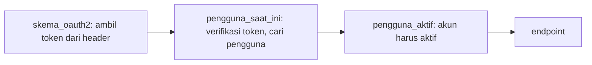

# Proteksi Endpoint

## Tujuan pembelajaran

Setelah membaca halaman ini, kamu mampu:

- [ ] Menjelaskan alur token pada request: header `Authorization: Bearer ...`.
- [ ] Memakai `OAuth2PasswordBearer` untuk membaca token dari request.
- [ ] Menulis dependency `pengguna_saat_ini` yang memverifikasi token dan mencari pengguna.
- [ ] Melindungi endpoint hanya dengan menambah satu dependency.
- [ ] Membedakan penyebab `401` (token) dan `403` (akun tidak aktif).
- [ ] Mengenali apa yang tampil di `/openapi.json` untuk endpoint terlindungi.

## Prasyarat

- Sudah membaca [Token](token.md).
- Sudah membaca [Dependency Berantai](../05-dependency-injection/dependency-berantai.md). Halaman itu memakai header `X-Pengguna` buatan sendiri dan menyebut autentikasi sungguhan datang di modul ini.

!!! info "Versi yang diuji"
    Kode dan output di halaman ini dijalankan dengan **Python 3.14.7**, **FastAPI 0.162.0**, **PyJWT 2.15.1**, **pwdlib 0.3.1**, dan **python-multipart 0.0.32** di Windows. Daftar versi lain ada di [Versi yang dipakai di materi ini](../01-pengenalan/instalasi-dan-venv.md#versi-yang-dipakai-di-materi-ini). Versi lain dan sistem operasi lain **belum diuji**.

## Konsep

Token sudah bisa dibuat. Sekarang kita memakainya untuk **melindungi endpoint**: hanya request yang membawa token sah yang boleh lewat.

Klien mengirim token di header `Authorization`:

```text
Authorization: Bearer <token>
```

*Bearer* berarti "pembawa": siapa pun yang membawa token dianggap pemiliknya. Karena itu token harus dijaga seperti kata sandi, dan sebaiknya hanya dikirim lewat HTTPS pada aplikasi nyata.

Rantai pemeriksaannya sama dengan [Dependency Berantai](../05-dependency-injection/dependency-berantai.md):



## Kode lengkap

Simpan sebagai `main.py`:

```python title="main.py"
--8<-- "fastapi/07-autentikasi-keamanan/proteksi-endpoint/main.py"
```

## Penjelasan kode

### Skema OAuth2

```python
skema_oauth2 = OAuth2PasswordBearer(tokenUrl="token")
```

- `OAuth2PasswordBearer` adalah *callable* yang bisa dipakai di `Depends`. Ia membaca header `Authorization`, memeriksa bahwa isinya `Bearer` diikuti token, lalu menyerahkan token sebagai `str`. Bila header tidak ada atau salah bentuk, ia langsung menjawab `401` (dokumentasi FastAPI).
- `tokenUrl="token"` memberi tahu dokumentasi otomatis di mana klien mengambil token. Ia **tidak membuat** endpoint `/token`; endpoint itu tetap kita tulis sendiri.

### `pengguna_saat_ini`

```python
def pengguna_saat_ini(token: Annotated[str, Depends(skema_oauth2)]) -> PenggunaPublik:
    gagal = HTTPException(
        status_code=401,
        detail="Token tidak valid atau sudah kedaluwarsa",
        headers={"WWW-Authenticate": "Bearer"},
    )
    try:
        isi = jwt.decode(token, SECRET_KEY, algorithms=[ALGORITMA])
    except InvalidTokenError:
        raise gagal
    nama_pengguna = isi.get("sub")
    pengguna = pengguna_db.get(nama_pengguna) if nama_pengguna else None
    if pengguna is None:
        raise gagal
    return PenggunaPublik(nama_pengguna=nama_pengguna, aktif=pengguna["aktif"])
```

Dependency ini melakukan tiga hal berurutan:

1. Menerima token dari `skema_oauth2`.
2. Memverifikasi tanda tangan dan masa berlaku. Semua kegagalan token (diubah, kedaluwarsa, kunci salah, sembarang teks) ditangkap oleh `InvalidTokenError` dan dijawab dengan satu `401` yang sama.
3. Mencari pengguna dari klaim `sub`. Token yang sah tetapi penggunanya sudah tidak ada juga dijawab `401` yang sama.

Satu pesan untuk semua kegagalan token disengaja: klien tidak perlu tahu mana yang salah. Header `WWW-Authenticate: Bearer` menyertai setiap `401`.

### `pengguna_aktif` dan alias

```python
def pengguna_aktif(pengguna: Annotated[PenggunaPublik, Depends(pengguna_saat_ini)]) -> PenggunaPublik:
    if not pengguna.aktif:
        raise HTTPException(status_code=403, detail="Akun tidak aktif")
    return pengguna


PenggunaLogin = Annotated[PenggunaPublik, Depends(pengguna_aktif)]
```

Sama seperti rantai di Modul 05: identitas jelas tetapi tidak diizinkan dijawab `403`. `PenggunaLogin` adalah alias agar endpoint cukup menulis satu parameter.

### Melindungi endpoint

```python
@app.get("/saya", response_model=PenggunaPublik)
def profil_saya(pengguna: PenggunaLogin):
    return pengguna
```

Seluruh perlindungan hanyalah parameter `pengguna: PenggunaLogin`. Endpoint terbuka seperti `/info` tidak punya parameter itu. Karena `pengguna` sudah berupa data pengguna yang terverifikasi, endpoint bisa langsung memakainya (misalnya `pengguna.nama_pengguna`).

### Endpoint percobaan

`/debug/nonaktifkan/...` dan `/debug/hapus/...` hanya untuk mencoba kasus akun nonaktif dan pengguna terhapus. Di aplikasi nyata endpoint seperti ini tidak boleh ada.

## Menjalankan

```powershell
$env:SECRET_KEY = "isi-dengan-kunci-acak-hasil-perintah-di-halaman-token"
fastapi dev main.py
```

Server berjalan di `http://127.0.0.1:8000`. Jika port 8000 dipakai aplikasi lain, tambahkan `--port 8001` dan sesuaikan URL di bawah. Cara membuat kunci ada di halaman [Token](token.md).

## Mencoba request

Hasil di bawah dijalankan dengan `curl.exe` setelah mendaftarkan `budi` dan `sari`, dan login untuk mendapat token masing-masing.

### Tanpa token

| Request | Status | Isi |
|---|---|---|
| `GET /info` | `200` | `{"nama":"TugasKu","terbuka":true}` |
| `GET /saya` (tanpa header) | `401` | `{"detail":"Not authenticated"}`, header `www-authenticate: Bearer` |
| `GET /saya`, `Authorization: Basic abc` | `401` | pesan dan header yang sama |

Pesan `Not authenticated` berasal dari `OAuth2PasswordBearer`, sebelum `pengguna_saat_ini` sempat dijalankan.

### Dengan token

```powershell
curl.exe -H "Authorization: Bearer <token budi>" http://127.0.0.1:8000/saya
```

```json
{"nama_pengguna":"budi","aktif":true}
```

`GET /catatan-pribadi` dengan token yang sama menghasilkan:

```json
{"pemilik":"budi","catatan":["Belajar proteksi endpoint"]}
```

### Token yang bermasalah

| Token | Status | Isi |
|---|---|---|
| `bukan-token` | `401` | `{"detail":"Token tidak valid atau sudah kedaluwarsa"}` |
| Kedaluwarsa | `401` | pesan yang sama |
| Ditandatangani kunci lain | `401` | pesan yang sama |
| Sah, tetapi penggunanya (`hantu`) tidak ada | `401` | pesan yang sama |
| Token `budi` setelah akunnya dihapus | `401` | pesan yang sama |

Semuanya disertai header `www-authenticate: Bearer`. Token kedaluwarsa dan token berkunci lain dibuat dengan skrip pendek yang memakai `jwt.encode` dan kunci yang sama (atau kunci lain).

### Akun nonaktif

Setelah `POST /debug/nonaktifkan/sari`, token `sari` yang masih sah menghasilkan:

```text
HTTP/1.1 403 Forbidden
{"detail":"Akun tidak aktif"}
```

`401` berarti token tidak diterima. `403` berarti token diterima dan pengguna dikenali, tetapi tidak diizinkan.

### Dokumentasi otomatis

`/openapi.json` mencatat skema keamanan `OAuth2PasswordBearer` dengan `tokenUrl` `token`, dan menandai `/saya` dengan `security: [{"OAuth2PasswordBearer": []}]`, sedangkan `/info` tidak punya `security`. Menurut dokumentasi FastAPI, halaman `/docs` lalu menampilkan tombol **Authorize** dan ikon gembok pada endpoint terlindungi. Tampilan itu dan alur login lewat `/docs` **belum diverifikasi** lewat browser.

## Kesalahan umum

| Kesalahan | Akibat |
|---|---|
| Lupa menambah dependency pada endpoint yang seharusnya dilindungi | Endpoint terbuka untuk siapa saja. Periksa tiap endpoint. |
| Hanya memeriksa token tanpa mencari penggunanya | Token milik pengguna yang sudah dihapus tetap lolos (teruji: kasus pengguna terhapus dijawab `401` karena pengguna dicari). |
| Menjawab pesan berbeda untuk tiap kegagalan token | Membantu penyerang. Gunakan satu pesan. |
| Menjawab `200` dengan pesan "tidak diizinkan" | Klien tidak bisa membedakan. Gunakan `401` dan `403`. |
| Mengirim token lewat HTTP biasa pada aplikasi nyata | Token bisa disadap. Gunakan HTTPS. |
| Mengira ikon gembok di `/docs` berarti endpoint sudah aman | Gembok hanya dokumentasi; perlindungan datang dari dependency. |
| Mengirim token di URL (*query string*) | Bisa tercatat di log dan riwayat. Gunakan header. |

## Latihan

1. **Dasar.** Mengapa `GET /saya` tanpa token menjawab `Not authenticated`, bukan pesan dari `pengguna_saat_ini`?
2. **Prediksi.** Apa status request dengan token `budi` setelah akun `budi` dihapus? Mengapa?
3. **Praktik.** Lindungi endpoint baru `GET /halo` yang mengembalikan `{"halo": <nama pengguna>}`.
4. **Analisis.** Apa beda `401` dan `403` pada halaman ini?

??? success "Kunci jawaban"
    Jawaban 1 sampai 4 mengacu pada hasil uji di atas. Jawaban 3 adalah penerapan pola yang teruji pada `/saya`.

    1. `OAuth2PasswordBearer` menolak lebih dulu bila header `Authorization: Bearer ...` tidak ada, sehingga dependency lain tidak sempat dijalankan.
    2. `401`: token masih sah secara tanda tangan, tetapi `pengguna_saat_ini` tidak menemukan pengguna `budi` di `pengguna_db`.
    3. ```python
       @app.get("/halo")
       def halo(pengguna: PenggunaLogin):
           return {"halo": pengguna.nama_pengguna}
       ```
    4. `401`: token tidak ada atau tidak sah (identitas tidak terbukti). `403`: identitas terbukti tetapi akun tidak aktif.

## Ringkasan

- Klien mengirim token di header `Authorization: Bearer <token>`.
- `OAuth2PasswordBearer(tokenUrl="token")` membaca token dari header dan menjawab `401` bila tidak ada.
- `pengguna_saat_ini` memverifikasi token, lalu mencari pengguna dari klaim `sub`; semua kegagalan dijawab satu `401`.
- Melindungi endpoint cukup dengan menambah satu parameter dependency (`PenggunaLogin`).
- `401` untuk identitas yang tidak terbukti, `403` untuk identitas yang terbukti tetapi tidak diizinkan.
- Endpoint terlindungi tercatat dengan skema keamanan di `/openapi.json`.

## Langkah berikutnya

Lanjut ke [Refresh Token dan Pencabutan](refresh-token.md) untuk memperbarui dan mencabut token, lalu [Otorisasi](otorisasi.md). Atau kembali ke daftar materi di [Modul 07: Autentikasi dan Keamanan](index.md).
