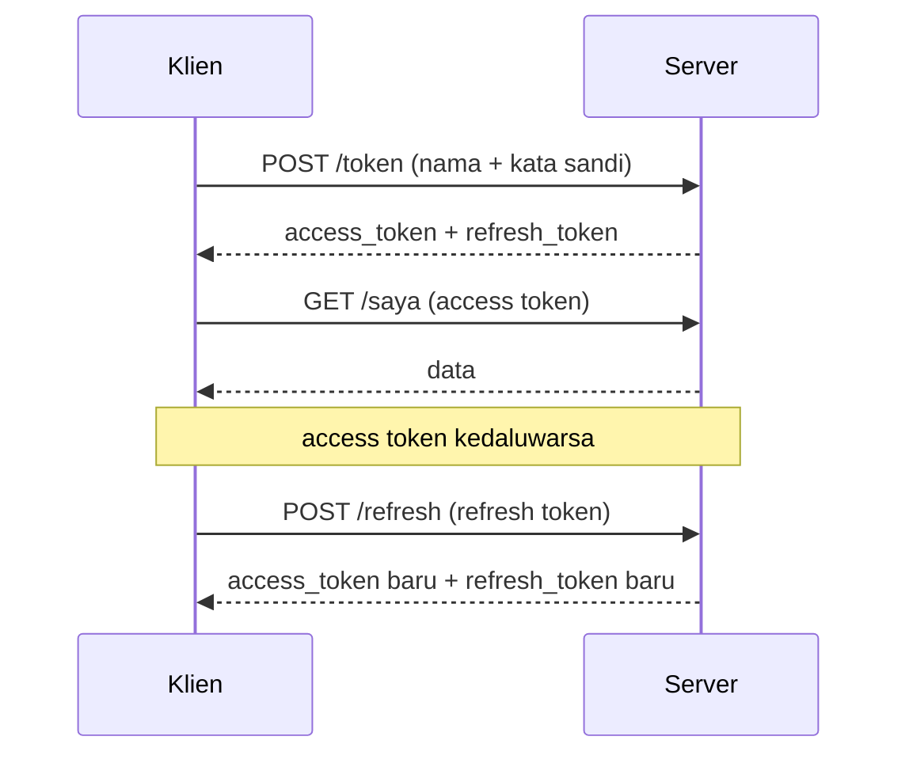

# Refresh Token dan Pencabutan Token

## Tujuan pembelajaran

Setelah membaca halaman ini, kamu mampu:

- [ ] Menjelaskan masalah token yang berlaku lama dan token yang berlaku singkat.
- [ ] Membedakan *access token* dan *refresh token*.
- [ ] Memperbarui sesi dengan refresh token, dengan rotasi (sekali pakai).
- [ ] Mencabut token dengan pengenal unik (`jti`) dan daftar blokir.
- [ ] Mencegah token dipakai untuk tujuan yang salah lewat klaim `jenis`.
- [ ] Menyebut batasan pendekatan ini.

## Prasyarat

- Sudah membaca [Token](token.md) dan [Proteksi Endpoint](proteksi-endpoint.md).

!!! info "Versi yang diuji"
    Kode dan output di halaman ini dijalankan dengan **Python 3.14.7**, **FastAPI 0.162.0**, **PyJWT 2.15.1**, dan **pwdlib 0.3.1** di Windows. Daftar versi lain ada di [Versi yang dipakai di materi ini](../01-pengenalan/instalasi-dan-venv.md#versi-yang-dipakai-di-materi-ini). Versi lain dan sistem operasi lain **belum diuji**.

## Konsep

### Dilema masa berlaku

Token yang kita buat di [Token](token.md) tetap sah sampai `exp`, dan tidak bisa dicabut seketika karena server tidak menyimpan apa pun tentangnya. Masa berlaku jadi dilema:

| Masa berlaku | Keuntungan | Kerugian |
|---|---|---|
| Panjang (berhari-hari) | Pengguna jarang login ulang | Token yang bocor berbahaya lama |
| Pendek (menit) | Token bocor cepat tak berguna | Pengguna harus login ulang terus |

### Dua token

Solusi yang umum: **dua token**.

| | Access token | Refresh token |
|---|---|---|
| Dipakai untuk | Memanggil endpoint terlindungi | Hanya untuk meminta pasangan token baru |
| Masa berlaku | Singkat (menit) | Panjang (hari) |
| Dikirim | Di setiap request | Hanya ke `/refresh` dan `/keluar` |
| Dicatat server | Tidak (kecuali dicabut) | Ya, agar bisa dicabut |

Alurnya:



Klien login sekali; selama refresh token sah, ia bisa memperbarui access token tanpa kata sandi. Bila refresh token dicabut, pembaruan berhenti.

### Rotasi

Pada **rotasi**, setiap refresh token hanya boleh dipakai **sekali**. Saat dipakai, server menghapusnya dan memberi pasangan baru. Bila refresh token lama dipakai lagi, server tahu ada yang janggal.

### Pengenal token: `jti`

Untuk mencabut token tertentu, server perlu mengenalinya. Klaim `jti` (*JWT ID*) adalah pengenal unik per token. Server menyimpan `jti` yang sah (refresh) atau yang diblokir (access).

!!! warning "Bukan keamanan penuh"
    Contoh ini menyimpan daftar `jti` di memori agar jelas. Daftar itu hilang saat server dimulai ulang, dan tidak dibagi antar beberapa proses server. Aplikasi nyata menyimpannya di basis data atau penyimpanan bersama. Selain itu, kunci dan pengiriman token lewat HTTPS tetap wajib (lihat [Token](token.md)).

## Kode lengkap

Simpan sebagai `main.py`:

```python title="main.py"
--8<-- "fastapi/07-autentikasi-keamanan/refresh-token/main.py"
```

## Penjelasan kode

### Masa berlaku dari environment

```python
DETIK_AKSES = int(os.environ.get("DETIK_AKSES", 15 * 60))
DETIK_REFRESH = int(os.environ.get("DETIK_REFRESH", 7 * 24 * 3600))
```

Bawaannya 15 menit untuk access token dan 7 hari untuk refresh token. Dapat diubah lewat environment agar kedaluwarsa mudah diuji (saat percobaan di bawah, `DETIK_AKSES=3`).

### Dua penyimpanan di server

```python
refresh_aktif: dict[str, str] = {}  # jti refresh token yang sah -> nama pengguna
akses_dicabut: set[str] = set()     # jti access token yang sudah dicabut
```

Refresh token memakai **daftar putih** (hanya yang terdaftar yang sah), sedangkan access token memakai **daftar blokir** (semua sah kecuali yang diblokir). Alasannya: access token dipakai di setiap request dan tidak dicatat, jadi yang dicatat hanya pengecualiannya.

### Membuat token dengan `jenis` dan `jti`

```python
isi = {"sub": nama, "jenis": jenis, "jti": jti, "exp": ...}
```

Klaim `jenis` (`akses` atau `refresh`) mencegah token dipakai untuk tujuan yang salah. `decode` menolak token yang jenisnya tidak sesuai, sehingga refresh token tidak bisa dipakai memanggil `/saya`, dan access token tidak bisa dipakai di `/refresh`.

### `/token`, `/refresh`, dan `/keluar`

- `/token` memverifikasi kata sandi (dengan hash tiruan seperti sebelumnya), lalu `terbitkan_pasangan` membuat kedua token dan mencatat `jti` refresh.
- `/refresh` memeriksa refresh token, lalu `refresh_aktif.pop(jti)`. Bila `jti` tidak ada, token itu sudah dipakai atau dicabut: `401`. Bila ada, pasangan baru diterbitkan.
- `/keluar` memasukkan `jti` access token yang sedang dipakai ke `akses_dicabut`, dan menghapus refresh token yang dikirim dari `refresh_aktif`.

### Memeriksa daftar blokir

```python
def isi_token_akses(token) -> dict:
    isi = decode(token, "akses")
    if isi["jti"] in akses_dicabut:
        raise HTTPException(status_code=401, detail="Token sudah dicabut", ...)
    return isi
```

Setiap endpoint terlindungi (`/saya`) memakai dependency ini, sehingga token yang dicabut ditolak walau tanda tangan dan `exp`-nya masih sah.

## Menjalankan

```powershell
$env:SECRET_KEY = "isi-dengan-kunci-acak-hasil-perintah-di-halaman-token"
fastapi dev main.py
```

Server berjalan di `http://127.0.0.1:8000`. Jika port 8000 dipakai aplikasi lain, tambahkan `--port 8001` dan sesuaikan URL di bawah. Untuk mengulang percobaan kedaluwarsa, isi juga `$env:DETIK_AKSES = "3"` sebelum menjalankan server.

## Mencoba request

Hasil di bawah dijalankan dengan `curl.exe`, dengan `DETIK_AKSES=3` dan pengguna contoh `budi` (kata sandi demo `sandi-budi-123`). Login mengembalikan tiga bidang: `access_token`, `refresh_token`, dan `token_type`.

### Penggunaan wajar

| Langkah | Status | Isi |
|---|---|---|
| `POST /token` kata sandi salah | `401` | `{"detail":"Nama pengguna atau kata sandi salah"}` |
| `GET /saya` dengan access token | `200` | `{"nama":"budi"}` |
| Tunggu lebih dari 3 detik, lalu `GET /saya` dengan access token yang sama | `401` | `{"detail":"Token tidak valid atau sudah kedaluwarsa"}` |
| `POST /refresh` dengan refresh token (JSON `{"refresh_token": "..."}`) | `200` | pasangan token baru (tiga bidang yang sama) |
| `GET /saya` dengan access token baru | `200` | `{"nama":"budi"}` |

### Jenis token tertukar

| Langkah | Status | Isi |
|---|---|---|
| `GET /saya` dengan **refresh** token | `401` | `{"detail":"Token tidak valid atau sudah kedaluwarsa"}` |
| `POST /refresh` dengan **access** token | `401` | pesan yang sama |

### Rotasi

| Langkah | Status | Isi |
|---|---|---|
| `POST /refresh` dengan refresh token yang **sudah dipakai** | `401` | `{"detail":"Refresh token sudah dipakai atau dicabut"}` |
| `POST /refresh` dengan teks sembarang | `401` | `{"detail":"Token tidak valid atau sudah kedaluwarsa"}` |

### Keluar (pencabutan)

`POST /keluar` dengan header `Authorization: Bearer <access token>` dan body `{"refresh_token": "<refresh token>"}` menghasilkan `204`. Sesudahnya:

| Langkah | Status | Isi |
|---|---|---|
| `GET /saya` dengan access token yang dicabut | `401` | `{"detail":"Token sudah dicabut"}` |
| `POST /refresh` dengan refresh token yang dicabut | `401` | `{"detail":"Refresh token sudah dipakai atau dicabut"}` |

Semua `401` disertai header `www-authenticate: Bearer`.

### Dokumentasi otomatis

Tampilan visual Swagger UI dan alur dari tombol *Authorize* **belum diverifikasi** lewat browser.

## Batasan yang perlu kamu ketahui

- **Penyimpanan di memori.** Setelah server dimulai ulang, daftar refresh token yang sah kosong (semua pengguna harus login ulang), dan daftar blokir juga kosong (access token yang pernah dicabut kembali sah sampai kedaluwarsa). Bagian ini adalah penalaran dari kode, tidak diuji dengan memulai ulang server.
- **Daftar blokir terus bertambah.** Entri access token yang sudah kedaluwarsa tidak dibersihkan di contoh ini.
- **Tidak terbagi antar proses.** Beberapa proses server tidak berbagi memori, sehingga pencabutan di satu proses tidak terlihat di proses lain.
- **Refresh token yang dicuri.** Rotasi membantu mendeteksi pemakaian ganda, tetapi contoh ini tidak menyimpan keluarga token atau mencabut semuanya saat ada pemakaian ganda.
- **Pencabutan access token hanya berlaku setelah dicatat.** Token yang bocor tanpa diketahui tetap sah sampai `exp`; itulah sebabnya access token dibuat singkat.

## Kesalahan umum

| Kesalahan | Akibat |
|---|---|
| Memakai satu token berumur panjang | Token bocor berbahaya lama dan tidak bisa dicabut. |
| Tidak memeriksa `jenis` token | Refresh token bisa dipakai memanggil API biasa (teruji: ditolak karena pemeriksaan `jenis`). |
| Refresh token bisa dipakai berkali-kali | Pencurian sulit terdeteksi. Pakai rotasi. |
| Menyimpan refresh token di tempat yang mudah diakses skrip (misalnya penyimpanan lokal browser) | Mudah dicuri. Pertimbangan penyimpanan di sisi klien tidak dibahas di sini. |
| Mengira daftar blokir di memori cukup untuk produksi | Hilang saat restart dan tidak terbagi antar proses. |
| Tidak mencabut refresh token saat keluar | Sesi tetap bisa diperbarui walau pengguna sudah keluar. |

## Latihan

1. **Dasar.** Mengapa access token dibuat singkat dan refresh token panjang?
2. **Prediksi.** Apa status `POST /refresh` dengan refresh token yang sama dipakai dua kali? Mengapa?
3. **Prediksi 2.** Apa status `GET /saya` dengan refresh token?
4. **Analisis.** Mengapa access token memakai daftar blokir, tetapi refresh token memakai daftar sah?

??? success "Kunci jawaban"
    Jawaban 2 dan 3 mengacu pada hasil uji di atas. Jawaban 1 dan 4 adalah penalaran dari penjelasan halaman ini.

    1. Access token dikirim di setiap request, sehingga paling rawan bocor; masa singkat membatasi kerusakan. Refresh token jarang dikirim dan dicatat server sehingga bisa dicabut, jadi masa panjang membuat pengguna jarang login ulang.
    2. `401` dengan `Refresh token sudah dipakai atau dicabut`: rotasi menghapus `jti` setelah pemakaian pertama.
    3. `401` dengan `Token tidak valid atau sudah kedaluwarsa`: `decode` menolak karena `jenis` bukan `akses`.
    4. Access token dipakai di setiap request dan tidak dicatat server; yang dicatat hanya yang dicabut (daftar blokir) supaya penyimpanan kecil. Refresh token sedikit dan perlu dikendalikan penuh, jadi hanya yang terdaftar yang sah.

## Ringkasan

- Access token singkat untuk memanggil API, refresh token panjang untuk memperbarui sesi.
- Rotasi: refresh token hanya sekali pakai.
- `jti` mengenali token tertentu; server menyimpan `jti` refresh yang sah dan `jti` access yang diblokir.
- Klaim `jenis` mencegah token dipakai untuk tujuan yang salah.
- `/keluar` mencabut access token yang sedang dipakai dan refresh token terkait.
- Penyimpanan di memori hanya untuk belajar; aplikasi nyata memakai penyimpanan bersama yang tahan restart.

## Langkah berikutnya

Lanjut ke [Otorisasi](otorisasi.md), atau kembali ke daftar materi di [Modul 07: Autentikasi dan Keamanan](index.md).
