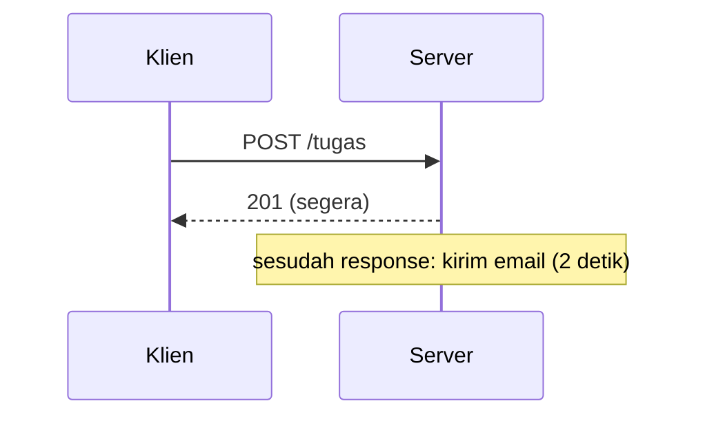

# Background Task

## Tujuan pembelajaran

Setelah membaca halaman ini, kamu mampu:

- [ ] Menjelaskan apa itu background task dan kapan memakainya.
- [ ] Menjalankan pekerjaan setelah response dikirim dengan `BackgroundTasks` dan `add_task`.
- [ ] Menambahkan background task dari dependency.
- [ ] Membuktikan bahwa klien tidak menunggu pekerjaan latar belakang.
- [ ] Menyebut batasan: berjalan di proses yang sama, hilang bila server mati, dan kegagalannya tidak sampai ke klien.

## Prasyarat

- Sudah membaca [Middleware](middleware.md).
- Sudah membaca [Dependency dengan yield](../05-dependency-injection/dependency-yield.md) dan [Dependency Sederhana](../05-dependency-injection/dependency-sederhana.md).

!!! info "Versi yang diuji"
    Kode dan output di halaman ini dijalankan dengan **Python 3.14.7** dan **FastAPI 0.162.0** di Windows. Daftar versi lain ada di [Versi yang dipakai di materi ini](../01-pengenalan/instalasi-dan-venv.md#versi-yang-dipakai-di-materi-ini). Versi lain dan sistem operasi lain **belum diuji**.

## Konsep

### Masalah: klien menunggu pekerjaan yang tidak ia butuhkan

Saat tugas dibuat, kita ingin mengirim email pemberitahuan. Mengirim email butuh waktu, tetapi klien tidak perlu menunggunya selesai untuk tahu bahwa tugasnya sudah dibuat. Kalau pengiriman dilakukan di dalam endpoint, setiap pembuatan tugas terasa lambat.

**Background task** (tugas latar belakang) menjalankan pekerjaan **setelah response dikirim**. Menurut dokumentasi FastAPI, ini cocok untuk hal seperti notifikasi email atau memproses berkas setelah menjawab klien.



### Kapan bukan background task

`BackgroundTasks` berjalan di **proses yang sama** dengan aplikasi. Dokumentasi FastAPI membedakan:

| Pakai `BackgroundTasks` | Pakai alat seperti Celery |
|---|---|
| Pekerjaan kecil, butuh akses ke objek aplikasi | Komputasi berat yang tidak perlu satu proses dengan aplikasi |
| Tanpa infrastruktur tambahan | Butuh pialang pesan (RabbitMQ, Redis) dan lebih banyak pengaturan |
| Tidak perlu jalan lintas banyak server | Bisa jalan di banyak proses dan server |

Celery tidak dibahas di materi ini.

## Kode lengkap

Simpan sebagai `main.py`:

```python title="main.py"
--8<-- "fastapi/08-struktur-proyek/background-task/main.py"
```

## Penjelasan kode

### Fungsi tugas

```python
def kirim_notifikasi(email: str, judul: str) -> None:
    time.sleep(2)  # pura-pura mengirim email
    tulis_log(f"email terkirim ke {email}: tugas '{judul}' dibuat")
```

Fungsi tugas adalah fungsi Python biasa. Menurut dokumentasi FastAPI, ia boleh `def` atau `async def`. Di sini `time.sleep(2)` mensimulasikan pengiriman email yang lambat, dan hasilnya ditulis ke berkas `notifikasi.log` supaya terlihat.

### `BackgroundTasks` dan `add_task`

```python
@app.post("/tugas", status_code=201)
def buat_tugas(data: TugasBaru, background_tasks: BackgroundTasks, _: Annotated[None, Depends(catat_akses)]):
    background_tasks.add_task(kirim_notifikasi, data.email, data.judul)
    return {"pesan": "Tugas dibuat", "judul": data.judul}
```

- Parameter bertipe `BackgroundTasks` diisi FastAPI secara otomatis.
- `add_task(fungsi, *args, **kwargs)` mendaftarkan fungsi beserta argumennya. **Fungsinya tidak dipanggil di sini**, hanya dijadwalkan; tulis nama fungsi tanpa kurung.
- Endpoint langsung `return`. Tugas dijalankan setelah response dikirim.

### Dependency yang menambah tugas

```python
def catat_akses(background_tasks: BackgroundTasks) -> None:
    background_tasks.add_task(tulis_log, "akses: POST /tugas dicatat oleh dependency")
```

`BackgroundTasks` bisa dideklarasikan di endpoint, dependency, atau sub-dependency. Menurut dokumentasi FastAPI, objeknya dipakai bersama sehingga semua tugas digabung dan dijalankan setelah response.

### Pembanding dan tugas yang gagal

- `/tugas-lambat` menjalankan `kirim_notifikasi` langsung di dalam request, sebagai pembanding waktu.
- `/tugas-gagal` menjadwalkan tugas yang melempar exception, untuk melihat dampaknya.

## Menjalankan

```powershell
fastapi dev main.py
```

Server berjalan di `http://127.0.0.1:8000`. Jika port 8000 dipakai aplikasi lain, tambahkan `--port 8001` dan sesuaikan URL di bawah. Berkas `notifikasi.log` dibuat di folder kerja saat tugas pertama berjalan.

## Mencoba request

Hasil di bawah dijalankan dengan `curl.exe`. Body `{"judul":"Belajar background task","email":"budi@contoh.id"}` dikirim dari berkas JSON dengan header `Content-Type: application/json`. `-w` menampilkan waktu total request.

### Dengan background task

```powershell
curl.exe -s -o NUL -w "status=%{http_code} waktu=%{time_total}s\n" -X POST http://127.0.0.1:8000/tugas -H "Content-Type: application/json" -d "@tugas.json"
```

```text
status=201 waktu=0.023866s
```

Response tiba dalam sekitar 24 milidetik. `GET /log` **segera sesudahnya** hanya berisi catatan dari dependency:

```json
["[20:43:33] akses: POST /tugas dicatat oleh dependency"]
```

Tiga detik kemudian, `GET /log`:

```json
["[20:43:33] akses: POST /tugas dicatat oleh dependency","[20:43:35] email terkirim ke budi@contoh.id: tugas 'Belajar background task' dibuat"]
```

Email "terkirim" pada `:35`, dua detik setelah `:33`, yaitu **setelah** klien menerima response. Tugas dari dependency berjalan lebih dulu karena ditambahkan lebih dulu.

### Tanpa background task (pembanding)

```text
{"pesan":"Tugas dibuat","judul":"Belajar background task"}
status=201 waktu=2.004079s
```

Pekerjaan yang sama di dalam request membuat klien menunggu sekitar 2 detik.

### Validasi gagal

`POST /tugas` dengan `{"judul":"ab",...}` menghasilkan `422`. Tiga detik kemudian `GET /log` kosong (`[]`): karena fungsi endpoint tidak pernah dijalankan, tidak ada tugas yang dijadwalkan. (Dependency `catat_akses` juga tidak sampai menambah tugas pada kasus ini, sehingga log benar-benar kosong.)

### Tugas yang gagal

`POST /tugas-gagal` menjadwalkan tugas yang melempar `RuntimeError`:

```text
{"pesan":"Tugas dibuat","judul":"Belajar background task"}
status=201
```

Klien tetap menerima `201`, karena response sudah dikirim sebelum tugas berjalan. Terminal server mencatat:

```text
ERROR:    Exception in ASGI application
    raise RuntimeError(f"gagal mengirim email ke {email}")
```

Server tetap hidup (`GET /log` menjawab `200` sesudahnya). Artinya **kegagalan tugas latar belakang tidak pernah sampai ke klien**; satu-satunya jejaknya ada di log server. Tangani dan catat kegagalan di dalam fungsi tugas sendiri.

### Dokumentasi otomatis

Background task tidak muncul di `/openapi.json`. Tampilan Swagger UI **belum diverifikasi** lewat browser.

## Batasan yang perlu kamu ketahui

- **Tidak tahan restart.** Tugas hidup di memori proses (dokumentasi FastAPI). Bila server berhenti atau jatuh sebelum tugas selesai, tugas itu hilang. Hal ini tidak diuji dengan menghentikan server di tengah tugas.
- **Satu proses.** Tidak ada antrean bersama antar proses atau server.
- **Tidak ada percobaan ulang** otomatis bila tugas gagal.
- **Bersaing dengan aplikasi.** Pekerjaan CPU berat dalam tugas tetap memakai sumber daya yang sama dengan aplikasi (dokumentasi FastAPI).
- **Urutan relatif terhadap middleware.** Menurut dokumentasi FastAPI, tugas latar belakang berjalan setelah semua middleware.
- **Tidak ada hasil untuk klien.** Klien tidak tahu tugas sudah selesai atau gagal; pakai mekanisme lain (status yang bisa dicek) bila perlu.

## Kesalahan umum

| Kesalahan | Akibat |
|---|---|
| Memanggil fungsinya di `add_task` (`add_task(kirim(...))`) | Fungsi berjalan sekarang di dalam request, dan hasilnya yang dijadwalkan. Tulis `add_task(kirim, arg1, arg2)`. Tidak diuji di sini. |
| Menaruh pekerjaan penting yang tidak boleh hilang | Hilang bila server mati. Pakai antrean tugas terpisah. |
| Mengira klien diberi tahu bila tugas gagal | Tidak; klien tetap mendapat `201` (teruji). |
| Pekerjaan sangat lama dan berat sebagai tugas | Membebani proses aplikasi. Pertimbangkan Celery dan sejenisnya. |
| Menulis ke berkas dengan mode `"w"` | Menimpa isi berkas setiap kali. Contoh di sini memakai `"a"` (tambah). |
| Menganggap `time.sleep` di tugas `def` selalu aman | Pada contoh ini tidak menghambat request lain secara terukur; perilaku saat banyak tugas bersamaan tidak diuji. |

## Latihan

1. **Dasar.** Berapa kira-kira waktu respons `POST /tugas` dan `POST /tugas-lambat`? Mengapa berbeda?
2. **Prediksi.** Apa isi `GET /log` tepat setelah `POST /tugas` berhasil, dan dua detik kemudian?
3. **Praktik.** Tambahkan tugas kedua pada `buat_tugas` yang mencatat `"tugas dibuat: <judul>"`. Dalam urutan apa semua tugas berjalan?
4. **Analisis.** Mengapa kegagalan tugas latar belakang tidak mengubah status `201`?

??? success "Kunci jawaban"
    Jawaban 1, 2, dan 4 mengacu pada hasil uji di atas. Jawaban 3 adalah penalaran dari urutan yang teramati, tidak dijalankan.

    1. Sekitar 0,02 detik untuk `/tugas`, dan sekitar 2 detik untuk `/tugas-lambat`. Pada `/tugas`, pengiriman email berjalan setelah response; pada `/tugas-lambat`, di dalam request.
    2. Tepat setelah response: hanya baris dari dependency (`akses: POST /tugas dicatat oleh dependency`). Dua detik kemudian: baris email muncul juga.
    3. Tambahkan `background_tasks.add_task(tulis_log, f"tugas dibuat: {data.judul}")` sebelum atau sesudah `add_task(kirim_notifikasi, ...)`. Tugas berjalan dalam urutan ditambahkan: yang dari dependency dulu, lalu yang ditambahkan di endpoint sesuai urutan baris kodenya.
    4. Response sudah dikirim sebelum tugas dijalankan, jadi status tidak bisa berubah. Kegagalannya hanya tercatat di log server.

## Ringkasan

- Background task menjalankan pekerjaan setelah response dikirim, sehingga klien tidak menunggu.
- Deklarasikan parameter `BackgroundTasks` dan daftarkan dengan `add_task(fungsi, *args, **kwargs)`.
- `BackgroundTasks` bisa dipakai di endpoint dan dependency; semua tugas digabung.
- Tugas berjalan di proses yang sama: hilang bila server mati, tanpa percobaan ulang, dan kegagalannya tidak sampai ke klien.
- Untuk pekerjaan berat atau yang tidak boleh hilang, pakai antrean tugas terpisah.

## Langkah berikutnya

Kembali ke daftar materi di [Modul 08: Struktur Proyek](index.md). Modul berikutnya adalah [Modul 09: Pengujian](../09-pengujian/index.md).
