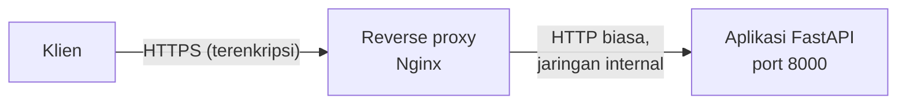

# Reverse Proxy dan HTTPS

## Tujuan pembelajaran

Setelah membaca halaman ini, kamu mampu:

- [ ] Menjelaskan apa itu *reverse proxy* dan mengapa HTTPS biasanya dihentikan di sana, bukan di aplikasi.
- [ ] Membaca konfigurasi Nginx yang meneruskan request ke aplikasi FastAPI dan menjelaskan setiap header yang diteruskan.
- [ ] Menjelaskan mengapa aplikasi harus diberi tahu proksi mana yang dipercaya (`FORWARDED_ALLOW_IPS`), dan apa akibatnya bila lupa.
- [ ] Memasang *health check* di Docker Compose yang memanggil `/kesehatan`, dan membuat proksi menunggu sampai aplikasi sehat.
- [ ] Membedakan yang sudah diuji (HTTPS dengan sertifikat *self-signed* di Linux) dari yang belum (sertifikat asli, internet publik).

## Prasyarat

- Sudah membaca [Container](container.md). Halaman ini memakai image TugasKU yang sama.
- Sudah membaca [Server Produksi](server-produksi.md), terutama bagian host, port, dan proksi.
- Docker Engine dan Docker Compose terpasang, serta `openssl` untuk membuat sertifikat percobaan.

!!! info "Versi yang diuji"
    Dijalankan di **Ubuntu Linux** dengan **Docker Engine 29.9.2**, **Docker Compose 5.6.1**, dan image **`nginx:stable-alpine`** (Nginx **1.30.6**). Aplikasinya adalah image dari [Proyek Praktik Tahap 6](proyek-tahap-6.md) (Python 3.14.9 di dalam image). Daftar versi lain ada di [Versi yang dipakai di materi ini](../01-pengenalan/instalasi-dan-venv.md#versi-yang-dipakai-di-materi-ini).

!!! warning "Halaman ini hanya memakai sertifikat percobaan"
    Yang diuji adalah sertifikat *self-signed* yang dibuat sendiri, di komputer yang sama. **Tidak** diuji: sertifikat dari otoritas asli (misalnya Let's Encrypt), nama domain, internet publik, pengalihan HTTP ke HTTPS, dan header keamanan seperti HSTS. Jangan menganggap konfigurasi ini cukup untuk produksi sungguhan.

## Konsep

Sejauh ini aplikasi menerima koneksi langsung dari klien lewat HTTP biasa. Di produksi, biasanya ada satu program lagi di depan aplikasi: **reverse proxy**. Klien tidak pernah berbicara dengan aplikasi, melainkan dengan proksi, dan proksi yang meneruskan request ke aplikasi.



| Istilah | Arti |
|---|---|
| **Reverse proxy** | Server di depan aplikasi yang menerima request dari klien dan meneruskannya ke aplikasi. |
| **TLS / HTTPS** | Enkripsi koneksi. HTTPS adalah HTTP di atas TLS. |
| **TLS termination** | Proksi yang membuka enkripsi, lalu meneruskan HTTP biasa ke aplikasi di jaringan internal. |
| **Sertifikat *self-signed*** | Sertifikat yang ditandatangani sendiri. Enkripsinya bekerja, tetapi peramban dan `curl` menolaknya karena tidak ada otoritas yang menjaminnya. Hanya untuk percobaan. |
| **Health check** | Pemeriksaan berkala apakah aplikasi masih hidup, dilakukan oleh Docker atau orkestrator. |

Karena enkripsi berhenti di proksi, aplikasi melihat request-nya masuk lewat HTTP biasa dari alamat proksi. Agar aplikasi tahu skema asli (`https`), host asli, dan alamat klien, proksi menambahkan header `X-Forwarded-*`. Tanpa informasi itu, URL yang dibuat aplikasi, misalnya alamat tujuan pengalihan, bisa memakai skema yang salah (lihat temuan nyata di bawah).

Ada dua sisi yang harus cocok:

1. **Proksi** mengirim header `X-Forwarded-Proto` dan kawan-kawannya.
2. **Aplikasi** mau mempercayai header itu, hanya dari proksi yang dikenal. Uvicorn memakai daftar alamat tepercaya yang bisa diatur lewat environment `FORWARDED_ALLOW_IPS`.

Header ini bisa dipalsukan oleh siapa pun yang berbicara langsung ke aplikasi. Karena itu aplikasi tidak boleh bisa dijangkau langsung dari luar; hanya proksi yang boleh.

## Kode lengkap

Berkas ada di `examples/fastapi/10-deployment/proxy-https/`.

### `nginx.conf`

```nginx title="nginx.conf"
--8<-- "fastapi/10-deployment/proxy-https/nginx.conf"
```

### `docker-compose.yml`

```yaml title="docker-compose.yml"
--8<-- "fastapi/10-deployment/proxy-https/docker-compose.yml"
```

## Penjelasan kode

### `nginx.conf`

| Baris | Fungsi |
|---|---|
| `listen 443 ssl;` | Nginx menerima koneksi HTTPS di port 443 di dalam container. Compose memetakannya ke port 8443 di komputer. |
| `ssl_certificate`, `ssl_certificate_key` | Jalur sertifikat dan kunci privat. Berkas dipasang dari folder `certs/` lewat Compose. |
| `proxy_pass http://api:8000;` | Meneruskan request ke layanan `api` pada port 8000. Nama `api` dikenali karena Compose menaruh kedua layanan di satu jaringan internal. |
| `proxy_set_header Host $http_host;` | Meneruskan `Host` persis seperti yang dikirim klien, **termasuk nomor port**. Lihat bagian temuan di bawah mengapa bukan `$host`. |
| `proxy_set_header X-Real-IP $remote_addr;` | Alamat IP klien yang terhubung ke Nginx. |
| `proxy_set_header X-Forwarded-For $proxy_add_x_forwarded_for;` | Daftar alamat yang dilewati request. |
| `proxy_set_header X-Forwarded-Proto $scheme;` | Skema koneksi asli dari klien (`https`). Ini yang membuat aplikasi tahu bahwa klien memakai HTTPS. |

Tidak ada blok `listen 80` yang mengalihkan HTTP ke HTTPS. Itu sengaja ditinggalkan dan tidak diuji.

### `docker-compose.yml`

- Layanan **`api`** dibangun dari folder `proyek/tahap-6` (`build: ../../proyek/tahap-6`). Layanan ini **tidak punya `ports:`**, sehingga port 8000 tidak dibuka ke komputer; hanya layanan lain di jaringan Compose yang bisa menjangkaunya.
- `TUGASKU_SECRET_KEY: ${TUGASKU_SECRET_KEY:?...}` mengambil rahasia dari environment atau `.env`, dan gagal dengan pesan bila kosong.
- `TUGASKU_LINGKUNGAN: produksi` menyalakan aturan produksi, termasuk menutup `/docs`. `TUGASKU_ORIGIN_DIIZINKAN` berisi alamat HTTPS yang dipakai klien.
- `FORWARDED_ALLOW_IPS: "*"` membuat Uvicorn mempercayai header `X-Forwarded-*` dari alamat mana pun. `"*"` hanya aman di sini karena `api` tidak dibuka ke luar. Di tempat lain, isi dengan alamat proksi yang sebenarnya.
- **`healthcheck`** menjalankan `curl --fail --silent http://127.0.0.1:8000/kesehatan` di dalam container `api` setiap 10 detik (`interval`), dengan batas waktu 3 detik (`timeout`). Setelah 3 kegagalan berturut-turut (`retries`), container ditandai `unhealthy`. `start_period` memberi 10 detik pertama untuk aplikasi mulai tanpa dihitung gagal. `--fail` membuat `curl` keluar dengan kode galat bila status HTTP bukan 2xx.
- Layanan **`proxy`** memakai image `nginx:stable-alpine`, memasang `nginx.conf` ke `/etc/nginx/conf.d/default.conf` dan folder `certs` secara baca-saja (`:ro`).
- `depends_on` dengan `condition: service_healthy` membuat Nginx baru dinyalakan setelah `api` berstatus sehat, jadi proksi tidak menerima request sebelum aplikasi siap.

Endpoint `/kesehatan` adalah *liveness*: hanya memeriksa bahwa proses menjawab, tanpa menyentuh basis data (lihat [Proyek Praktik Tahap 6](proyek-tahap-6.md)). `/siap` memeriksa basis data dan lebih cocok untuk pertanyaan "siap menerima trafik?".

## Menjalankan

Dari folder `examples/fastapi/10-deployment/proxy-https`:

```bash
# 1. Buat sertifikat percobaan (berlaku 1 hari). Jangan di-commit, jangan dipakai di produksi.
mkdir certs
openssl req -x509 -newkey rsa:2048 -nodes -days 1 \
  -keyout certs/server.key -out certs/server.crt \
  -subj "/CN=localhost" -addext "subjectAltName=DNS:localhost"

# 2. Isi rahasia (kunci acak) lewat environment
export TUGASKU_SECRET_KEY=$(python3 -c 'import secrets; print(secrets.token_hex(32))')

# 3. Bangun dan jalankan
docker compose up -d --build

# 4. Migrasi basis data sekali (volume Compose masih kosong)
docker compose run --rm -w /data api alembic -c /code/alembic.ini upgrade head

# 5. Periksa lewat HTTPS
curl -k https://localhost:8443/kesehatan
curl -k https://localhost:8443/siap

# 6. Bersihkan setelah selesai
docker compose down -v
rm -r certs
```

`-k` memberi tahu `curl` agar menerima sertifikat *self-signed*. Tanpa `-k`, `curl` menolak.

## Mencoba

Semua hasil di bawah berasal dari eksekusi nyata di Ubuntu.

### HTTPS dan health check

| Percobaan | Hasil |
|---|---|
| `docker compose up -d --build` | `api` dinyalakan dulu; Compose menunggu `Container ... Healthy`, baru `proxy` dinyalakan |
| `docker compose ps` | `api`: `Up ... (healthy)`, port `8000/tcp` **tidak dipublikasikan**; `proxy`: `0.0.0.0:8443->443/tcp` |
| `curl -k https://localhost:8443/kesehatan` | `200`, `{"status":"ok"}` |
| `curl -k https://localhost:8443/siap` | `200`, `{"status":"siap"}` |
| `curl https://localhost:8443/kesehatan` (tanpa `-k`) | gagal, `curl` keluar dengan kode `60` (sertifikat tidak dipercaya) |
| `docker pause` pada container `api`, tunggu | status terbaca `unhealthy` pada pengecekan 10 detik setelah dijeda (jumlah kegagalan beruntun tidak dicatat dengan benar) |
| `docker unpause` lalu tunggu | status kembali `healthy` |

### Temuan nyata 1: `Host $host` menghilangkan nomor port

Aplikasi mengalihkan `/tugas/` (dengan garis miring akhir) ke `/tugas`. Alamat tujuan pengalihan dibuat dari header `Host` dan skema. Pada konfigurasi pertama saya, `Host $host`:

```text
HTTP/1.1 307 Temporary Redirect
location: https://localhost/tugas
```

Nomor port `8443` hilang: klien yang mengikuti pengalihan ini akan mencoba port 443 dan gagal. Penyebabnya, variabel `$host` di Nginx tidak menyertakan port. Setelah diganti `$http_host`:

```text
HTTP/1.1 307 Temporary Redirect
location: https://localhost:8443/tugas
```

### Temuan nyata 2: tanpa kepercayaan pada proksi, skema salah

Dengan `FORWARDED_ALLOW_IPS` diubah dari `"*"` menjadi `"127.0.0.1"` (proksi Nginx berada di alamat lain di jaringan Compose, sehingga tidak dipercaya), permintaan yang sama menghasilkan:

```text
HTTP/1.1 307 Temporary Redirect
location: http://localhost:8443/tugas
```

Skemanya turun menjadi `http`, padahal klien memakai HTTPS. Ini terjadi tanpa pesan galat apa pun. Klien yang mengikuti pengalihan akan mencoba HTTP biasa ke port HTTPS. Setelah dikembalikan ke `"*"`, hasilnya benar lagi.

Jadi ada dua hal yang harus benar sekaligus: proksi mengirim `X-Forwarded-Proto`, **dan** aplikasi mempercayai proksi itu.

## Yang belum diuji

- Sertifikat dari otoritas asli (Let's Encrypt atau lainnya), pembaruannya, dan nama domain asli.
- Pengalihan dari HTTP (port 80) ke HTTPS.
- Header keamanan seperti HSTS, dan pengaturan TLS lanjutan (versi protokol, *cipher*).
- Proksi selain Nginx (Traefik, Caddy, penyeimbang beban cloud).
- Instruksi `HEALTHCHECK` di dalam `Dockerfile` (yang diuji hanya `healthcheck` di Compose), dan probe Kubernetes.
- `curl` untuk health check pada image yang lebih kecil. Image `python:3.14` yang dipakai memiliki `curl`; image `slim` tidak diuji.
- Berapa kali health check gagal sebelum `unhealthy` secara tepat, dan perilaku `restart` terhadap container `unhealthy` (Docker Engine tidak otomatis memulai ulang container hanya karena `unhealthy`; ini penjelasan umum yang tidak diuji di sini).
- Docker Desktop di Windows dan macOS.

## Kesalahan umum

| Kesalahan | Akibat |
|---|---|
| Memakai `Host $host` di Nginx saat port bukan 80/443 | Alamat pengalihan kehilangan nomor port. Pakai `$http_host`. |
| Tidak mengatur `FORWARDED_ALLOW_IPS` | Aplikasi mengira request masuk lewat `http`; alamat pengalihan memakai skema salah. Tidak ada pesan galat. |
| `FORWARDED_ALLOW_IPS: "*"` sementara aplikasi bisa dijangkau langsung dari luar | Siapa pun bisa memalsukan `X-Forwarded-*`. Jangan membuka port aplikasi ke luar. |
| Membuka `ports: "8000:8000"` di layanan `api` bersama proksi | Aplikasi bisa dijangkau tanpa melewati HTTPS. |
| Meng-commit `server.key` | Kunci privat bocor. Sertifikat percobaan pun sebaiknya tidak di-commit. |
| Memakai sertifikat *self-signed* untuk pengguna sebenarnya | Peramban menolak atau memperingatkan; hanya untuk percobaan. |
| Menjadikan `/siap` sebagai health check liveness | Bila basis data sesaat tidak terjangkau, container ditandai tidak sehat padahal prosesnya hidup. Pilih `/kesehatan` untuk liveness. (Alasan umum; tidak diuji.) |
| Health check memakai `curl` di image yang tidak punya `curl` | Pemeriksaan selalu gagal. Pastikan perintahnya ada di image. |
| Menjalankan migrasi setelah `up` dan mengira `/siap` menjamin tabel ada | `/siap` hanya memeriksa basis data bisa dijangkau. Jalankan migrasi dulu. |

## Latihan

1. **Dasar.** Apa yang dimaksud TLS termination, dan di bagian mana dalam contoh ini enkripsi berakhir?
2. **Analisis.** Mengapa layanan `api` sengaja tidak punya `ports:`?
3. **Prediksi.** Bila `X-Forwarded-Proto $scheme;` dihapus dari `nginx.conf` tetapi `FORWARDED_ALLOW_IPS: "*"` dipertahankan, apa skema pada `location` pengalihan `/tugas/`?
4. **Praktik.** Tambahkan blok `server` yang mendengarkan port 80 dan mengalihkan ke HTTPS. Coba dengan `curl -i`, dan catat apa yang kamu temukan, termasuk soal nomor port.

??? success "Kunci jawaban"
    Jawaban 3 adalah prediksi dari temuan nyata nomor 2 dan **tidak diuji langsung**. Jawaban 4 tidak diuji dan tidak ada kunci tunggal.

    1. Enkripsi berakhir di Nginx. Dari Nginx ke aplikasi, request berjalan sebagai HTTP biasa di jaringan internal Compose.
    2. Agar aplikasi hanya bisa dijangkau lewat proksi. Dengan begitu header `X-Forwarded-*` hanya datang dari proksi, dan semua lalu lintas melewati HTTPS.
    3. Kemungkinan `http`, karena aplikasi tidak menerima informasi skema asli. Alasannya sama dengan temuan nyata nomor 2, tetapi penyebabnya header yang tidak dikirim, bukan alamat yang tidak dipercaya. Ini penalaran, bukan hasil uji.
    4. Contoh arah: `server { listen 80; return 301 https://$http_host$request_uri; }`. Perhatikan bahwa port 80 di dalam container perlu dipetakan di Compose, dan nomor port pada alamat tujuan harus sesuai dengan port yang dibuka di komputer.

## Ringkasan

- Reverse proxy berdiri di depan aplikasi; Nginx menghentikan HTTPS dan meneruskan HTTP biasa ke aplikasi di jaringan internal.
- Proksi mengirim `X-Forwarded-Proto` dan kawan-kawannya; aplikasi harus mempercayai proksi itu lewat `FORWARDED_ALLOW_IPS`. Tanpa itu, skema pada alamat pengalihan salah tanpa pesan galat (teruji).
- Pakai `Host $http_host` di Nginx agar nomor port tidak hilang (teruji).
- Jangan buka port aplikasi ke luar; hanya proksi yang boleh menjangkaunya.
- `healthcheck` di Compose memanggil `/kesehatan`, dan `depends_on` dengan `service_healthy` membuat proksi menunggu aplikasi sehat (teruji).
- Sertifikat dan konfigurasi di halaman ini hanya untuk percobaan; sertifikat asli, pengalihan HTTP, dan HSTS belum diuji.

## Langkah berikutnya

Lanjut ke [Checklist Rilis](checklist-rilis.md), atau kembali ke daftar materi di [Modul 10: Deployment](index.md).
