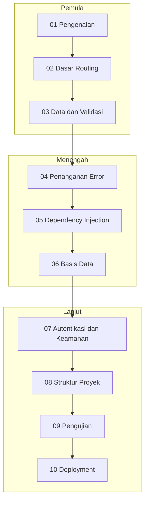

# Peta Belajar

Halaman ini memberi gambaran jalur belajar FastAPI dari awal sampai mahir: urutan modul, prasyarat setiap tahap, dan proyek praktik yang berkembang seiring kemajuanmu.

## Sebelum mulai

Materi ini **tidak mengajarkan Python dari nol**. Kamu perlu sudah mengenal:

- Dasar Python: variabel, fungsi, kondisi, perulangan, list dan dict, class, import, serta *type hints* dasar.
- Terminal dan editor kode.
- SQL dasar, yang baru dibutuhkan mulai [Modul 06](curriculum/06-basis-data/index.md).

Konsep HTTP diperkenalkan ulang secara ringkas di Modul 01.

Belum siap dengan Python? Tutorial resmi Python tersedia dalam [bahasa Indonesia](https://docs.python.org/id/3/tutorial/index.html) dan [bahasa Inggris](https://docs.python.org/3/tutorial/index.html). Tutorial itu ditujukan bagi programmer yang baru mengenal Python, jadi bila kamu belum pernah memprogram, mulailah dari materi pengantar pemrograman dasar.

## Jalur belajar

Ikuti modul secara berurutan. Setiap modul menyebut prasyaratnya di halaman indeksnya.

## Rincian per tahap

### Progres saat ini

| Modul | Halaman tersedia |
|---|---|
| 01 Pengenalan | 7 |
| 02 Dasar Routing | 5 (4 materi dan 1 latihan gabungan) |
| 03 Data dan Validasi | 7 (6 materi dan 1 proyek praktik) |
| 04 Penanganan Error | 5 (4 materi dan 1 proyek praktik) |
| 05 Dependency Injection | 5 |
| 06 Basis Data | 7 (6 materi dan 1 proyek praktik) |
| 07 Autentikasi dan Keamanan | 7 (6 materi dan 1 proyek praktik) |
| 08 Struktur Proyek | 6 (5 materi dan 1 proyek refaktor) |
| 09 Pengujian | 7 (6 materi dan 1 proyek praktik) |
| 10 Deployment | 7 (6 materi dan 1 proyek praktik) |

### Pemula

| Modul | Kamu akan belajar | Status |
|---|---|---|
| [01 Pengenalan](curriculum/01-pengenalan/index.md) | Apa itu FastAPI, instalasi, aplikasi pertama, menjalankan server, dokumentasi interaktif, endpoint pertama, HTTP dan REST | 7 halaman tersedia, lihat [daftar materi Modul 01](curriculum/01-pengenalan/index.md) |
| [02 Dasar Routing](curriculum/02-dasar-routing/index.md) | Path parameter, query parameter, urutan route, dasar async/await | 4 dari 4 materi dan latihan gabungan tersedia: [Path Parameter](curriculum/02-dasar-routing/path-parameter.md), [Query Parameter](curriculum/02-dasar-routing/query-parameter.md), [Urutan Route](curriculum/02-dasar-routing/urutan-route.md), [Dasar Async/Await](curriculum/02-dasar-routing/async-await.md), [Latihan Gabungan](curriculum/02-dasar-routing/latihan-gabungan.md) |
| [03 Data dan Validasi](curriculum/03-data-validasi/index.md) | Type hints, request body, model Pydantic, validasi field, validasi path dan query parameter, response model | 7 halaman tersedia: [Type Hints untuk FastAPI](curriculum/03-data-validasi/type-hints.md), [Request Body](curriculum/03-data-validasi/request-body.md), [Model Pydantic](curriculum/03-data-validasi/model-pydantic.md), [Validasi Field](curriculum/03-data-validasi/validasi-field.md), [Validasi Path dan Query Parameter](curriculum/03-data-validasi/validasi-path-query.md), [Response Model](curriculum/03-data-validasi/response-model.md), [Proyek Praktik Tahap 1](curriculum/03-data-validasi/proyek-tahap-1.md) |

Halaman yang sudah tersedia di Modul 01, sesuai urutan baca yang disarankan:

1. [Apa itu FastAPI](curriculum/01-pengenalan/apa-itu-fastapi.md)
2. [Instalasi dan Virtual Environment](curriculum/01-pengenalan/instalasi-dan-venv.md)
3. [Aplikasi Pertama](curriculum/01-pengenalan/aplikasi-pertama.md)
4. [Menjalankan Server](curriculum/01-pengenalan/menjalankan-server.md)
5. [Dokumentasi Interaktif](curriculum/01-pengenalan/dokumentasi-interaktif.md)
6. [Endpoint Pertama](curriculum/01-pengenalan/endpoint-pertama.md)
7. [HTTP dan REST](curriculum/01-pengenalan/http-dan-rest.md)

### Menengah

| Modul | Kamu akan belajar | Status |
|---|---|---|
| [04 Penanganan Error](curriculum/04-penanganan-error/index.md) | Status code, `HTTPException`, error validasi, handler kustom | 5 halaman tersedia: [Status Code](curriculum/04-penanganan-error/status-code.md), [HTTPException](curriculum/04-penanganan-error/http-exception.md), [Error Validasi](curriculum/04-penanganan-error/error-validasi.md), [Handler Error Kustom](curriculum/04-penanganan-error/handler-kustom.md), [Proyek Praktik Tahap 2](curriculum/04-penanganan-error/proyek-tahap-2.md) |
| [05 Dependency Injection](curriculum/05-dependency-injection/index.md) | Konsep dependency, dependency berantai, dependency per router | 5 halaman tersedia: [Konsep Dependency](curriculum/05-dependency-injection/konsep-dependency.md), [Dependency Sederhana](curriculum/05-dependency-injection/dependency-sederhana.md), [Dependency Berantai](curriculum/05-dependency-injection/dependency-berantai.md), [Dependency dengan yield](curriculum/05-dependency-injection/dependency-yield.md), [Dependency per Router](curriculum/05-dependency-injection/dependency-router.md) |
| [06 Basis Data](curriculum/06-basis-data/index.md) | Koneksi, model dan skema, CRUD, relasi, sesi async, migrasi | 7 halaman tersedia: [Koneksi ke Basis Data](curriculum/06-basis-data/koneksi-basis-data.md), [Model dan Skema](curriculum/06-basis-data/model-dan-skema.md), [Operasi CRUD](curriculum/06-basis-data/operasi-crud.md), [Relasi](curriculum/06-basis-data/relasi.md), [Sesi Basis Data Async](curriculum/06-basis-data/sesi-async.md), [Migrasi](curriculum/06-basis-data/migrasi.md), [Proyek Praktik Tahap 3](curriculum/06-basis-data/proyek-tahap-3.md) |

### Lanjut

| Modul | Kamu akan belajar | Status |
|---|---|---|
| [07 Autentikasi dan Keamanan](curriculum/07-autentikasi-keamanan/index.md) | Hashing password, token, proteksi endpoint, refresh token, otorisasi (termasuk scope), CORS | 7 halaman tersedia: [Hashing Password](curriculum/07-autentikasi-keamanan/hashing-password.md), [Token](curriculum/07-autentikasi-keamanan/token.md), [Proteksi Endpoint](curriculum/07-autentikasi-keamanan/proteksi-endpoint.md), [Refresh Token dan Pencabutan](curriculum/07-autentikasi-keamanan/refresh-token.md), [Otorisasi](curriculum/07-autentikasi-keamanan/otorisasi.md), [CORS](curriculum/07-autentikasi-keamanan/cors.md), [Proyek Praktik Tahap 4](curriculum/07-autentikasi-keamanan/proyek-tahap-4.md) |
| [08 Struktur Proyek](curriculum/08-struktur-proyek/index.md) | Router modular, konfigurasi, middleware, background task, lifespan | 6 halaman tersedia: [Router Modular](curriculum/08-struktur-proyek/router-modular.md), [Konfigurasi dan Environment](curriculum/08-struktur-proyek/konfigurasi-environment.md), [Middleware](curriculum/08-struktur-proyek/middleware.md), [Background Task](curriculum/08-struktur-proyek/background-task.md), [Lifespan](curriculum/08-struktur-proyek/lifespan.md), [Proyek: Memecah TugasKu](curriculum/08-struktur-proyek/refaktor-tugasku.md) |
| [09 Pengujian](curriculum/09-pengujian/index.md) | Pengujian endpoint, fixture, override dependency, basis data uji, pengujian async, mock | 7 halaman tersedia: [Pengujian Endpoint](curriculum/09-pengujian/pengujian-endpoint.md), [Fixture](curriculum/09-pengujian/fixture.md), [Override Dependency](curriculum/09-pengujian/override-dependency.md), [Basis Data untuk Pengujian](curriculum/09-pengujian/basis-data-pengujian.md), [Pengujian Async](curriculum/09-pengujian/pengujian-async.md), [Mock dan Monkeypatch](curriculum/09-pengujian/mock-monkeypatch.md), [Proyek Praktik Tahap 5](curriculum/09-pengujian/proyek-tahap-5.md) |
| [10 Deployment](curriculum/10-deployment/index.md) | Server produksi, container, variabel environment, logging, reverse proxy dan HTTPS, checklist rilis | 7 halaman tersedia: [Server Produksi](curriculum/10-deployment/server-produksi.md), [Container](curriculum/10-deployment/container.md), [Variabel Environment](curriculum/10-deployment/variabel-environment.md), [Logging](curriculum/10-deployment/logging.md), [Reverse Proxy dan HTTPS](curriculum/10-deployment/reverse-proxy-https.md), [Checklist Rilis](curriculum/10-deployment/checklist-rilis.md), [Proyek Praktik Tahap 6](curriculum/10-deployment/proyek-tahap-6.md) |

## Proyek praktik

Selain contoh kecil di setiap bab, ada satu proyek berkelanjutan yang tumbuh bertahap, misalnya API manajemen tugas (to-do). Judul final proyek ditetapkan nanti.

| Tahap | Dikerjakan setelah | Hasil |
|---|---|---|
| 1 | Modul 03 | CRUD dalam memori dengan model Pydantic |
| 2 | Modul 04 | Validasi dan error terstruktur |
| 3 | Modul 06 | Penyimpanan di basis data |
| 4 | Modul 07 | Registrasi, login, dan endpoint yang dilindungi |
| 5 | Modul 09 | Rangkaian pengujian otomatis |
| 6 | Modul 10 | Dikemas dan siap deploy |

## Hasil akhir

Setelah menuntaskan seluruh jalur, kamu mampu:

- [ ] Menjelaskan peran HTTP, REST, dan ASGI dalam aplikasi FastAPI.
- [ ] Membuat endpoint dengan path parameter, query parameter, dan request body.
- [ ] Memvalidasi dan menserialisasi data dengan model Pydantic.
- [ ] Mengelola error dan status code secara konsisten.
- [ ] Memakai dependency injection untuk berbagi logika.
- [ ] Menghubungkan aplikasi ke basis data dan mengelola skema.
- [ ] Mengamankan API dengan autentikasi dan otorisasi.
- [ ] Menulis pengujian otomatis untuk endpoint.
- [ ] Menyusun proyek yang terstruktur dan men-deploy-nya.

## Cara memakai materi

1. Baca tujuan pembelajaran di awal setiap bab.
2. Ketik sendiri kode contoh, jangan hanya menyalin, lalu jalankan.
3. Bandingkan hasilnya dengan bagian "hasil yang diharapkan".
4. Kerjakan latihan sebelum lanjut ke bab berikutnya.

!!! info "Rencana, bukan janji"
    Daftar topik di atas adalah rencana dan dapat berubah saat materi ditulis. Kolom *Status* menunjukkan halaman yang benar-benar sudah ada.
